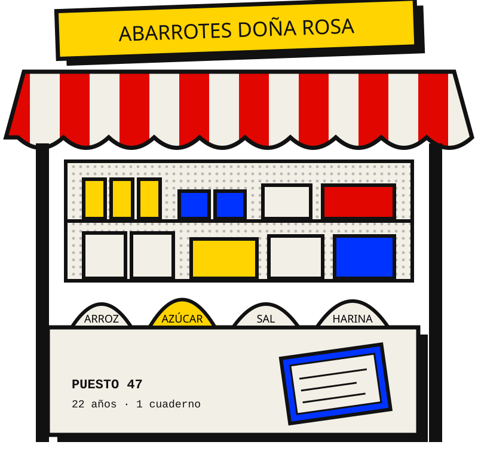
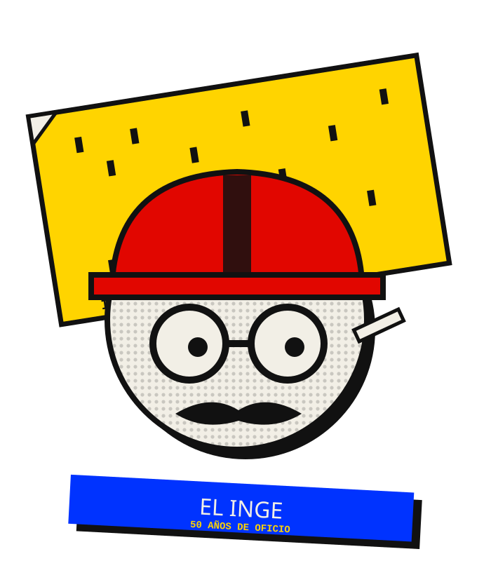
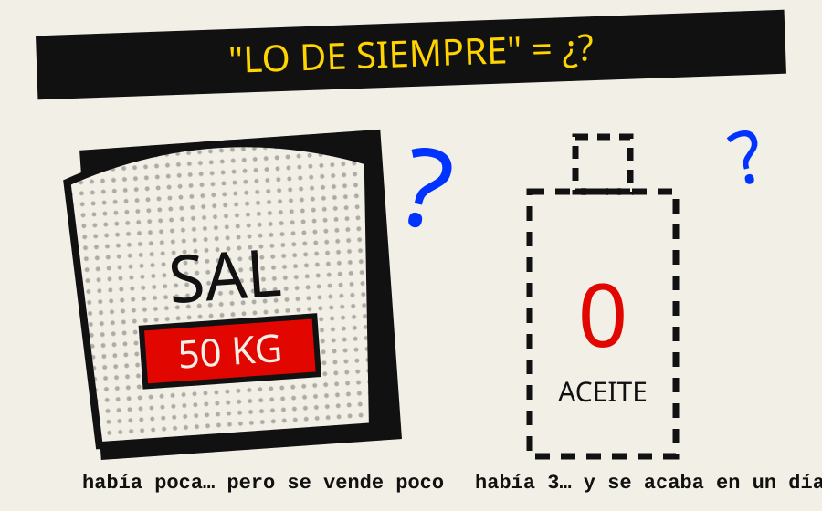
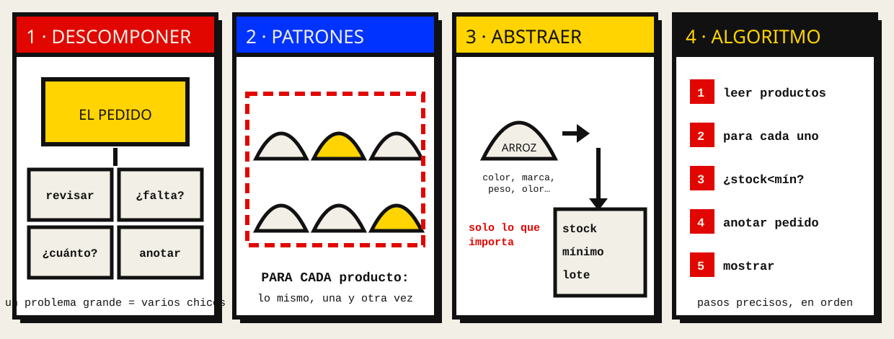
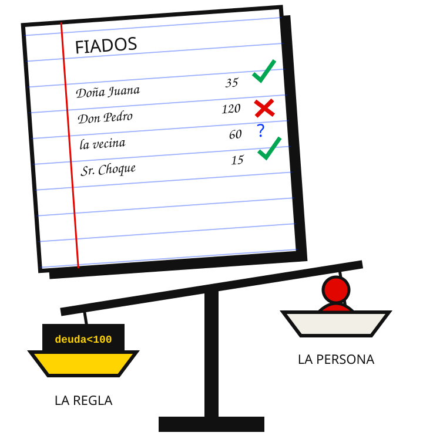

::: {.estilo-capitulo acento="rojo" motivo="rayas" imagen="../imagenes/cap01/apertura.svg"}
:::

::: {.callout-note collapse="true"}
## Ficha del capítulo
- **Objetivo de aprendizaje:** convertir un problema cotidiano y ambiguo en un algoritmo preciso, escrito en pseudocódigo, verificado a mano con una prueba de escritorio y traducido a un programa corto.
- **Prerrequisitos:** ninguno. Solo ganas de pensar despacio.
- **Proyecto guía:** nace **Caserita**, el sistema del puesto de Doña Rosa. Aquí escribimos su primera pieza: el algoritmo que decide qué productos hay que reponer.
:::

::: {.grito}
Primero se piensa.\
Después se teclea.
:::

Este capítulo no tiene computadoras. Bueno, casi: aparece una al final, y para entonces ya no la vas a necesitar tanto. Aquí vamos a aprender lo que pasa **antes** de escribir código, que es justamente lo que ninguna herramienta, ni la más inteligente, puede hacer por ti: entender bien un problema y describir su solución sin ambigüedad.

| Si llegas hasta el final, podrás… | Lo practicas en… |
|---|---|
| Reconocer un algoritmo en la vida diaria | @sec-c01-orden |
| Explicar por qué una instrucción vaga produce errores | @sec-c01-entropia |
| Descomponer, abstraer y escribir pseudocódigo | @sec-c01-analisis |
| Verificar un algoritmo a mano y buscar sus bordes | @sec-c01-contencion |
| Convertir tu pseudocódigo en un buen pedido para una IA | @sec-c01-ia |

: Ruta del capítulo {#tbl-c01-ruta}

## Orden {#sec-c01-orden}

### El puesto de Doña Rosa

::: {.figura-der ancho="44%"}
{#fig-c01-puesto}

Doña Rosa tiene un puesto de abarrotes en el mercado. Arroz, azúcar, fideo, aceite, harina, sal. Lleva veintidós años ahí, y su sistema de información funciona: está en su cabeza y en un cuaderno de tapas azules.

Cada sábado en la noche hace lo mismo:

1. Abre el cuaderno.
2. Recorre los estantes, producto por producto.
3. Si de algo queda poco, lo anota en la lista del pedido.
4. El domingo temprano va donde el mayorista con esa lista.
:::

Eso, aunque Doña Rosa no lo sepa, **es un algoritmo**. Tiene un inicio, pasos ordenados, una decisión que se repite y un final. Funciona, no se equivoca, y nadie tuvo que escribir una sola línea de código.

::: {.pizarra}
**Pizarra del Inge**

Un **algoritmo** es una secuencia finita de pasos precisos que, a partir de unos datos de entrada, produce un resultado.

Fíjate en las tres palabras que importan: *finita* (termina), *precisos* (no hay que adivinar), *resultado* (sirve para algo). La computadora es solo una de las muchas cosas que pueden ejecutar un algoritmo. Doña Rosa es otra.
:::

### Los cinco rasgos de todo algoritmo

Donald Knuth, uno de los padres de la informática como disciplina, describió cinco rasgos que todo algoritmo debe tener [@knuth1997]. Pongámoslos a prueba con el sábado de Doña Rosa:

| Rasgo | Qué exige | ¿Lo cumple el sábado de Doña Rosa? |
|---|---|---|
| **Finitud** | Terminar después de un número finito de pasos | Sí: los estantes se acaban y el recorrido también |
| **Definición** | Cada paso debe ser preciso, sin ambigüedad | **A medias:** "si queda poco" solo lo entiende ella |
| **Entrada** | Recibir cero o más datos | Sí: lo que hay en los estantes |
| **Salida** | Producir al menos un resultado | Sí: la lista del pedido |
| **Efectividad** | Cada paso debe poder hacerse de verdad, con lápiz y papel | Sí: mirar, contar y anotar |

: Los cinco rasgos de un algoritmo, aplicados al puesto {#tbl-c01-rasgos}

Mira la segunda fila. El algoritmo de Doña Rosa funciona **porque ella lo ejecuta**: el "poco" vive en su experiencia. Ese hueco, que hoy no molesta a nadie, es la grieta por donde va a entrar el desorden. Guárdalo en la memoria: es el tema de todo el capítulo.

### La metáfora que nos acompañará todo el libro

Este libro entero ocurre en un **mercado**. No es un capricho: un mercado es un ejemplo excelente de un sistema vivo que mantiene su orden peleando todos los días contra el desorden.

| En el mercado | En el software | Dónde lo veremos |
|---|---|---|
| El puesto de Doña Rosa | Un programa | Este capítulo |
| El cuaderno de tapas azules | Los datos | Caps. 3 y 9 |
| La manera de anotar y decidir | El algoritmo | Caps. 1 y 4 |
| Los pasillos y las reglas del mercado | La arquitectura | Cap. 10 |
| Las caseras que se pasan pedidos | Las API | Cap. 12 |
| El sobrino que ahora ayuda en el puesto | El equipo | Cap. 14 |
| El inspector de la alcaldía | Las pruebas y la seguridad | Caps. 15 y 16 |
| El ayudante que nunca duerme y a veces inventa | La IA | Parte II |
| ¿Quién es dueño de lo que sabe el mercado? | La soberanía de datos | Parte IV |

: El mercado como mapa del libro {#tbl-c01-metafora}

::: {.figura-izq ancho="36%"}
{#fig-c01-inge}

Y no recorrerás el mercado solo. Te acompaña **el Inge**: un ingeniero con cincuenta años de oficio que empezó perforando tarjetas y hoy revisa código generado por IA. Es un personaje, pero sus consejos son los que el oficio enseña a golpes.

Cuando veas una **pizarra** verde como las de este capítulo, es él quien habla. Sus pizarras guardan lo que vale la pena copiar en tu cuaderno: definiciones, trucos y advertencias.
:::

### Caserita: el sistema que vamos a construir

A lo largo del libro vamos a construir **Caserita**, el sistema del puesto. Empieza hoy como una lista escrita a mano y termina, muchos capítulos después, como un sistema completo. Cada capítulo le agrega una pieza, y cada pieza trae su propia entropía.

| Versión | Capítulo | Qué aprende Caserita |
|---|---|---|
| **0.1** | 1 (este) | Decidir qué reponer: un algoritmo en pseudocódigo |
| 0.2 | 2 | Convertirse en un programa de verdad en Python |
| 0.3 | 3 | Organizar productos, caseros y fiados en estructuras de datos |
| 0.5 | 9 | Recordar todo en una base de datos |
| 0.7 | 12 | Hablar con otros puestos mediante una API |
| 1.0 | 19 | Funcionar en producción, todos los días, sin Doña Rosa mirando |
| 2.0 | Partes II y III | Tener un asistente con IA que responde preguntas sobre el puesto |

: La hoja de ruta de Caserita {#tbl-c01-caserita}

## Entropía {#sec-c01-entropia}

### Lo que pasa cuando el puesto crece

Un día Doña Rosa se enferma y su sobrino Marco tiene que hacer el pedido del sábado. Ella, desde la cama, le dice:

> —Fíjate qué falta y pide lo de siempre.

Marco es inteligente y tiene buena voluntad. Aun así, vuelve el domingo con 50 kilos de sal (había poca, pero se vende poco) y sin aceite (había tres botellas, que a Marco le parecieron suficientes, pero el aceite se acaba en un día).

::: {.figura-pie lado="izq" ancho="62%"}
{#fig-c01-marco}
:::

¿Falló Marco? No. **Falló la instrucción.** "Fíjate qué falta" y "lo de siempre" son frases cargadas de conocimiento que solo existe en la cabeza de Doña Rosa:

- ¿Cuánto es "poco" para cada producto?
- ¿Cuánto es "lo de siempre"?
- ¿Qué pasa con lo que se vende rápido y con lo que se vende lento?

::: {.recorte}
Una instrucción ambigua es una instrucción que obliga a quien la recibe a adivinar. Y cuando dos personas adivinan, adivinan distinto.
:::

### Las tres fuentes de la ambigüedad

Si miras con cuidado la frase de Doña Rosa, el desorden entra por tres puertas distintas. Aprende a reconocerlas, porque vas a encontrarlas en cada requisito que te den en tu vida profesional:

| Puerta | Cómo se ve | En la frase de Doña Rosa | Cómo se cierra |
|---|---|---|---|
| **Palabras vagas** | Cantidades o cualidades sin número | "poco", "lo de siempre" | Convertirlas en números o reglas |
| **Conocimiento implícito** | Lo que "todo el mundo sabe" en el puesto | Que el aceite se vende rápido | Escribirlo como dato (por ejemplo, `alta_rotacion`) |
| **Casos no previstos** | Situaciones que nadie mencionó | ¿Y si es fin de mes? ¿Y si hay feriado? | Preguntar, y anotar la respuesta en la regla |

: Las tres puertas por donde entra la ambigüedad {#tbl-c01-puertas}

### La entropía, medida con números

Esto es **entropía en su sentido de información**: incertidumbre [@shannon1948]. Y lo bonito es que se puede medir.

Supongamos que en el puesto hay seis productos y que, para cada uno, Marco puede decidir "pedir" o "no pedir". ¿Cuántos pedidos distintos podría armar? Dos opciones para el primero, dos para el segundo… en total $2^6 = 64$ pedidos posibles. Doña Rosa solo tenía **uno** en mente.

Claude Shannon definió la incertidumbre de una situación con $N$ resultados igual de probables como:

$$H = \log_2 N \quad \text{bits}$$

Con la instrucción "fíjate qué falta", la incertidumbre de Marco era $H = \log_2 64 = 6$ bits: seis decisiones a ciegas. Con una regla precisa, solo queda un pedido posible, y $H = \log_2 1 = 0$ bits. **Escribir bien el algoritmo es, literalmente, bajar la entropía a cero.**

::: {.pizarra}
**Pizarra del Inge**

Cada bit de incertidumbre es una pregunta que alguien tendrá que adivinar. Si no la respondes tú al escribir el algoritmo, la responderá otro al ejecutarlo: Marco, un compañero de equipo… o una IA. Y cada uno la responderá a su manera.
:::

Mientras el conocimiento vive en una sola cabeza, la incertidumbre no se nota. En cuanto el sistema crece (otra persona, más productos, más días), cada ambigüedad se convierte en un error posible.

### Por qué la solución obvia no alcanza

La tentación de quien está aprendiendo a programar es sentarse y teclear: "hago un programa de inventario". Abre el editor, crea variables, escribe `if` por todas partes… y a las dos horas tiene un programa que funciona para el arroz, falla con el aceite y nadie, ni siquiera su autor, sabe explicar qué decide ni por qué.

El problema no era de código. Era de **pensamiento**. Fred Brooks lo explicó hace décadas: lo difícil del software no es escribirlo, sino decidir *qué* debe hacer exactamente; esa es su complejidad esencial, y ninguna herramienta la elimina [@brooks1987].

```{mermaid}
%%| label: fig-c01-caminos
%%| fig-cap: "Dos caminos para el mismo problema: teclear primero o pensar primero."
flowchart TB
  P[Problema ambiguo] --> T[Teclear de inmediato]
  P --> PI[Pensar primero]
  T --> C1[Código que adivina]
  PI --> A[Algoritmo preciso]
  C1 --> E[Errores que nadie entiende]
  A --> C2[Código que se explica solo]
```

## Análisis {#sec-c01-analisis}

En esta sección vamos a hacer lo que Marco no pudo: tomar el "fíjate qué falta" de Doña Rosa y convertirlo en algo que cualquiera, persona o máquina, ejecute igual. El camino tiene cuatro tramos, y cada uno usa una herramienta:

| Tramo | Herramienta | Pregunta que responde |
|---|---|---|
| 1 | Pensamiento computacional | ¿Cómo miro el problema? |
| 2 | Lógica | ¿Cómo decido sin adivinar? |
| 3 | Pseudocódigo | ¿Cómo escribo los pasos sin ambigüedad? |
| 4 | Prueba de escritorio | ¿Cómo sé que funciona antes de programar? |

: Los cuatro tramos del análisis {#tbl-c01-tramos}

### Pensamiento computacional: cuatro maneras de mirar un problema

Jeannette Wing popularizó la idea de que el pensamiento computacional es una habilidad para todos, no solo para programadores: formular problemas de manera que sus soluciones puedan ejecutarse con precisión [@wing2006]. Suele enseñarse en cuatro movimientos, y los cuatro ya están escondidos en el sábado de Doña Rosa:

{#fig-c01-movimientos}

| Movimiento | Pregunta que te haces | En el puesto de Doña Rosa |
|---|---|---|
| **Descomposición** | ¿En qué partes pequeñas se divide? | Revisar un producto, decidir si falta, calcular cuánto pedir, armar la lista |
| **Patrones** | ¿Qué se repite? | Para *cada* producto hago lo mismo |
| **Abstracción** | ¿Qué datos importan y cuáles sobran? | Importan stock, mínimo y lote. No importa el color del paquete |
| **Algoritmo** | ¿Cuáles son los pasos exactos? | La receta que vamos a escribir abajo |

: Los cuatro movimientos del pensamiento computacional {#tbl-c01-pc}

Vamos uno por uno, despacio.

**Descomponer** es aceptar que "hacer el pedido" es demasiado grande para pensarlo de un solo golpe. Lo partimos hasta que cada pedazo sea tan pequeño que su solución sea obvia: *mirar un producto* es obvio; *decidir si falta* es obvio si tengo una regla; *anotar* es obvio.

**Encontrar patrones** es notar que esos pedazos se repiten. No hay seis problemas distintos (uno por producto): hay **un** problema que se repite seis veces. Esa observación, en programación, se convertirá en un ciclo.

**Abstraer** es la que más cuesta y la que más vale. De todo lo que Doña Rosa sabe de un producto, para decidir el pedido solo necesitamos tres datos:

- **stock**: cuántas unidades hay ahora.
- **mínimo**: por debajo de cuánto hay que reponer. *Este es el "poco" que Marco no conocía.*
- **lote**: cuánto se compra cada vez. *Este es el "lo de siempre".*

::: {.pizarra}
**Pizarra del Inge**

Abstraer no es simplificar por flojera. Es **elegir qué ignorar a propósito**. Todo modelo miente un poco; uno bueno miente en lo que no importa.
:::

**Escribir el algoritmo** es juntar todo lo anterior en pasos precisos. Para eso nos faltan dos herramientas: la lógica, para decidir, y el pseudocódigo, para escribir.

### Lógica: decidir sin adivinar

Cada decisión de un algoritmo es una **proposición**: una afirmación que es verdadera o falsa, sin término medio. Entrena el ojo con estos ejemplos:

| Frase | ¿Es proposición? | Por qué |
|---|---|---|
| "Queda poco arroz" | No | ¿Cuánto es poco? Depende de quién lo diga |
| "El stock de arroz es menor que 10" | **Sí** | Se puede comprobar: es V o F |
| "El aceite se vende rápido" | No | "Rápido" no tiene número |
| "El aceite es de alta rotación" | **Sí**, si está anotado | Es un dato que vale V o F |
| "¿Hay sal?" | No | Es una pregunta; se convierte en "stock de sal > 0" |

: Entrenando el ojo: ¿proposición o no? {#tbl-c01-proposiciones}

Para construir proposiciones con números usamos **comparaciones**. Son las mismas que aprendiste en el colegio, con su forma en pseudocódigo y en Python:

| Significado | Matemática | Pseudocódigo | Python |
|---|:-:|:-:|:-:|
| menor que | $<$ | `<` | `<` |
| menor o igual | $\le$ | `<=` | `<=` |
| mayor que | $>$ | `>` | `>` |
| mayor o igual | $\ge$ | `>=` | `>=` |
| igual a | $=$ | `=` | `==` |
| distinto de | $\ne$ | `<>` | `!=` |

: Comparaciones en tres lenguajes {#tbl-c01-comparaciones}

::: {.callout-warning}
## Error típico: el igual
En Python, `=` **guarda** un valor y `==` **compara**. Confundirlos es el primer error de casi todos. En el pseudocódigo de este libro evitamos el problema usando `←` para guardar.
:::

Las proposiciones se combinan con tres conectores:

| Conector | Se escribe | Es verdadero cuando… | Ejemplo en el puesto |
|---|---|---|---|
| Y | `A Y B` | ambas son verdaderas | "es fin de mes **Y** el producto se vende mucho" |
| O | `A O B` | al menos una es verdadera | "falta stock **O** hay pedido especial" |
| NO | `NO A` | A es falsa | "**NO** está vencido" |

: Conectores lógicos {#tbl-c01-conectores}

::: {.callout-warning}
## Error típico: el "y" del lenguaje diario
Si Doña Rosa dice "trae arroz y fideo", habla de **dos cosas** que hay que traer. En lógica, `A Y B` es **una sola condición** que exige que las dos sean verdaderas a la vez. Cuando traduzcas del español a la lógica, pregúntate siempre: ¿esto es una lista de cosas o una condición doble?
:::

Ahora sí, la regla real. Doña Rosa, cuando le preguntamos con calma, nos explica que repone si queda menos del mínimo, **o** si es fin de mes y el producto es de los que más se venden (a fin de mes la gente cobra y compra más). Escribámosla con letras:

- **A** = stock < mínimo
- **B** = es fin de mes
- **C** = es producto de alta rotación

**Reponer = A O (B Y C)**

Los paréntesis no son decoración: dicen que primero se resuelve `B Y C` y luego se combina con `A`. La tabla de verdad nos muestra todos los casos posibles. Ocho filas, ninguna sorpresa:

| A | B | C | B Y C | A O (B Y C) | ¿Reponer? |
|:-:|:-:|:-:|:-:|:-:|---|
| V | V | V | V | **V** | Sí |
| V | V | F | F | **V** | Sí |
| V | F | V | F | **V** | Sí |
| V | F | F | F | **V** | Sí |
| F | V | V | V | **V** | Sí: fin de mes y se vende mucho |
| F | V | F | F | F | No |
| F | F | V | F | F | No |
| F | F | F | F | F | No |

: Tabla de verdad de la regla de reposición {#tbl-c01-verdad}

¿Por qué ocho filas? Porque cada letra puede ser V o F, y con tres letras hay $2^3 = 8$ combinaciones. Es la misma cuenta que hicimos con los pedidos de Marco: la tabla de verdad **recorre toda la incertidumbre** para que no quede ningún caso sin decidir.

::: {.callout-tip icon="false"}
## Truco del oficio
Si una condición tiene tres o más piezas, **haz la tabla de verdad antes de escribir el `if`**. Cinco minutos de tabla ahorran una tarde de depuración.
:::

### Pseudocódigo: escribir el algoritmo para humanos

El pseudocódigo es un algoritmo escrito en lenguaje casi natural, con una estructura casi de programa. No lo ejecuta ninguna máquina: lo ejecuta tu cabeza. Su único trabajo es **eliminar la ambigüedad** antes de que llegue al código.

Usaremos pocas palabras clave en todo el libro:

| Palabra clave | Para qué sirve | Se lee… |
|---|---|---|
| `INICIO` / `FIN` | Marcan dónde empieza y termina | "empieza", "termina" |
| `LEER` / `MOSTRAR` | Entrada y salida de datos | "recibo", "entrego" |
| `←` | Asignar un valor: `total ← 0` | "guarda en total el valor 0" |
| `SI … ENTONCES … SINO … FIN SI` | Decidir | "si pasa esto, haz aquello" |
| `PARA CADA … EN … HACER … FIN PARA` | Repetir sobre una colección | "con cada uno de…" |
| `MIENTRAS … HACER … FIN MIENTRAS` | Repetir mientras se cumpla algo | "sigue mientras…" |

: Vocabulario de pseudocódigo del libro {#tbl-c01-pseudo}

#### De la frase al algoritmo, en cuatro pasadas

Nadie escribe un buen algoritmo de una sola vez. Se escribe por **pasadas**: cada pasada elimina un poco de ambigüedad. Mira cómo la frase de Doña Rosa se va volviendo precisa.

**Pasada 1: la frase original.** Es lo que tenemos. Tiene 6 bits de incertidumbre.

```
Fíjate qué falta y pide lo de siempre.
```

**Pasada 2: separar en pasos.** Descomponemos. Ya hay orden, pero "poco" sigue siendo vago.

```
Mirar cada producto.
Si queda poco, anotarlo.
Llevar la lista al mayorista.
```

**Pasada 3: poner números.** Abstraemos: cada producto tiene `stock`, `minimo` y `lote`. "Poco" deja de existir.

```
PARA CADA producto EN productos HACER
    SI producto.stock < producto.minimo ENTONCES
        agregar (producto.nombre, producto.lote) a pedido
    FIN SI
FIN PARA
```

**Pasada 4: los casos no previstos.** Preguntamos a Doña Rosa y aparece el fin de mes. La regla completa entra al algoritmo, con entrada y salida explícitas. Esta es la versión final, y la verás como dibujo, como pseudocódigo y como programa.

```{mermaid}
%%| label: fig-c01-flujo
%%| fig-cap: "ReponerPuesto como diagrama de flujo: cada rombo es una proposición."
flowchart TD
  I([Inicio]) --> L[/Leer productos y fin de mes/]
  L --> V[pedido ← vacío]
  V --> Q{¿Quedan productos<br>por revisar?}
  Q -- No --> M[/Mostrar pedido/]
  M --> F([Fin])
  Q -- Sí --> T[Tomar el siguiente producto]
  T --> D{"stock < mínimo<br>O (fin de mes Y alta rotación)"}
  D -- Sí --> A[Agregar nombre y lote al pedido]
  D -- No --> Q
  A --> Q
```

::: {.panel-tabset}

## Pseudocódigo

```
ALGORITMO ReponerPuesto
INICIO
    LEER productos              // cada uno con: nombre, stock, minimo, lote, alta_rotacion
    LEER es_fin_de_mes
    pedido ← lista vacía

    PARA CADA producto EN productos HACER
        falta      ← producto.stock < producto.minimo
        empuje_mes ← es_fin_de_mes Y producto.alta_rotacion

        SI falta O empuje_mes ENTONCES
            agregar (producto.nombre, producto.lote) a pedido
        FIN SI
    FIN PARA

    MOSTRAR pedido
FIN
```

## Python

```{#lst-c01-reponer .python lst-cap="La función reponer_puesto: Caserita, versión 0.1"}
productos = [                                                         # <1>
    {"nombre": "arroz",  "stock": 4,  "minimo": 10, "lote": 25, "alta_rotacion": True},
    {"nombre": "sal",    "stock": 6,  "minimo": 5,  "lote": 10, "alta_rotacion": False},
    {"nombre": "aceite", "stock": 3,  "minimo": 6,  "lote": 12, "alta_rotacion": True},
    {"nombre": "fideo",  "stock": 20, "minimo": 8,  "lote": 20, "alta_rotacion": True},
]

def reponer_puesto(productos, es_fin_de_mes):
    pedido = []
    for producto in productos:                                        # <2>
        falta = producto["stock"] < producto["minimo"]                # <3>
        empuje_mes = es_fin_de_mes and producto["alta_rotacion"]
        if falta or empuje_mes:                                       # <4>
            pedido.append((producto["nombre"], producto["lote"]))
    return pedido

print(reponer_puesto(productos, es_fin_de_mes=False))
# [('arroz', 25), ('aceite', 12)]
print(reponer_puesto(productos, es_fin_de_mes=True))
# [('arroz', 25), ('aceite', 12), ('fideo', 20)]
```
1. La **abstracción** hecha datos: de cada producto guardamos solo lo que el algoritmo necesita.
2. El **patrón** que se repite: para cada producto, lo mismo.
3. Las proposiciones A, B y C de la tabla de verdad, ahora con nombre.
4. La regla `A O (B Y C)`, exactamente como la escribimos en lógica.

:::

Fíjate en algo importante: **el programa del @lst-c01-reponer es casi una traducción línea por línea del pseudocódigo.** `PARA CADA` se volvió `for`, `SI` se volvió `if`, `Y` se volvió `and`, `O` se volvió `or`. Cuando el pensamiento está bien hecho, programar se vuelve transcribir. Por eso este capítulo va primero, y por eso el capítulo 2 te va a parecer más fácil de lo que esperas.

### La prueba de escritorio: ejecutar el algoritmo con lápiz

Antes de confiar en un algoritmo, se ejecuta a mano con datos concretos, anotando cómo cambian las variables. A eso se le llama **prueba de escritorio**. Es tu primera prueba de software, y no necesita computadora.

El método es siempre el mismo:

1. Haz una tabla con una columna por cada variable que cambia.
2. Avanza una vuelta del ciclo por fila.
3. Calcula cada condición **a mano**, sin saltarte nada.
4. Compara el resultado final con lo que esperabas.

Hagámosla con los datos del @lst-c01-reponer y `es_fin_de_mes = Falso`:

| Vuelta | producto | stock < mínimo | fin de mes Y alta rotación | ¿Reponer? | pedido después |
|:-:|---|:-:|:-:|:-:|---|
| 1 | arroz | 4 < 10 → V | F | Sí | [arroz 25] |
| 2 | sal | 6 < 5 → F | F | No | [arroz 25] |
| 3 | aceite | 3 < 6 → V | F | Sí | [arroz 25, aceite 12] |
| 4 | fideo | 20 < 8 → F | F | No | [arroz 25, aceite 12] |

: Prueba de escritorio de ReponerPuesto, un sábado cualquiera {#tbl-c01-escritorio}

Resultado: arroz y aceite. **Justo lo que Marco no supo hacer.** Y la sal, que él compró de más, queda fuera por una razón explícita: su stock (6) no está por debajo de su mínimo (5).

::: {.callout-important}
## Ahora tú: el sábado de fin de mes
Repite la prueba de escritorio con `es_fin_de_mes = Verdadero`. Antes de mirar la solución, escribe tu tabla completa.
:::

::: {.callout-note collapse="true"}
## Solución
Cambia solo la vuelta 4: el fideo tiene stock suficiente (20 no es menor que 8), pero es fin de mes **y** es de alta rotación, así que `B Y C` es V y se repone. El pedido queda: arroz 25, aceite 12, fideo 20. La sal sigue fuera: no falta y no es de alta rotación.
:::

### El método de los cuatro pasos

En 1945, el matemático George Pólya propuso un método para resolver problemas que sigue siendo, ochenta años después, una de las mejores guías para empezar cualquier programa [@polya1945]. Si lo miras bien, es exactamente lo que hicimos en este capítulo:

```{mermaid}
%%| label: fig-c01-polya
%%| fig-cap: "Los cuatro pasos de Pólya, aplicados a programar."
flowchart LR
  E["Paso 1: Entender<br>¿qué entra?, ¿qué sale?"] --> P["Paso 2: Planear<br>descomponer y escribir"]
  P --> X["Paso 3: Ejecutar<br>escritorio y código"]
  X --> R["Paso 4: Revisar<br>bordes y mejoras"]
  R -.-> E
```

Nota el paso 1: **entender** va antes que todo. Muchos de los errores en software no son errores de programación: son problemas que nadie terminó de entender.

## Contención {#sec-c01-contencion}

El desorden de este capítulo es la **ambigüedad**. Estas prácticas lo frenan:

::: {.manifiesto}
1. Ningún programa sin antes escribir qué entra y qué sale.
2. Ninguna palabra vaga en el pseudocódigo: "poco", "mucho", "lo de siempre" se convierten en números.
3. Ninguna condición de tres piezas sin su tabla de verdad.
4. Ningún algoritmo sin prueba de escritorio con al menos tres casos.
5. Siempre un caso borde: cero, vacío, el número justo en el límite.
:::

### Los casos borde: donde vive la entropía

Un **caso borde** es un dato que está justo en el límite de una regla, o fuera de lo que la regla imaginó. Ahí es donde los algoritmos se rompen, porque es donde nadie miró.

¿Qué pasa si el stock de sal es **exactamente** 5 y su mínimo es 5? Con nuestra regla (`stock < mínimo`), **no** se repone. ¿Es eso lo que quiere Doña Rosa? No lo sabemos: hay que **preguntarle**. Esa pregunta, hecha a tiempo, vale más que cien líneas de código.

| Caso borde | ¿Qué hace nuestro algoritmo? | ¿Es correcto? |
|---|---|---|
| Lista de productos vacía | Devuelve un pedido vacío | Sí |
| stock = mínimo | No repone | **Preguntar a Doña Rosa** |
| stock negativo (error al anotar) | Repone | Funciona, pero esconde un error de datos |
| lote = 0 | Agrega un pedido de 0 unidades | No: hay que validar |

: Casos borde de ReponerPuesto {#tbl-c01-bordes}

### Errores típicos de quien empieza

Quien enseña a programar ve los mismos tropiezos una y otra vez. Aquí están, con su antídoto:

| Error | Cómo se nota | Antídoto |
|---|---|---|
| Empezar por el código | Muchas líneas, ninguna explicación | Escribir primero entrada, salida y pasos |
| Dejar palabras vagas | El algoritmo "depende" de quién lo ejecute | Cambiar cada adjetivo por un número o un dato |
| Confundir Y con O | Se repone de más o de menos | Tabla de verdad |
| Olvidar el caso vacío | Falla cuando no hay datos | Probar siempre con la lista vacía |
| Probar solo el caso feliz | Funciona en la demo y falla el sábado | Prueba de escritorio con bordes |

: Errores típicos y sus antídotos {#tbl-c01-errores}

### Ejercicios por niveles

**Nivel 1: reconocer.** Elige una tarea de tu casa (preparar un api, cargar el celular, pagar el pasaje del minibús). Escríbela como algoritmo y verifica los cinco rasgos de la @tbl-c01-rasgos.

**Nivel 2: precisar.** Toma esta instrucción: "si hace frío, abrígate bien". Encuentra las tres puertas de la ambigüedad (@tbl-c01-puertas) y reescríbela como proposición.

**Nivel 3: verificar.** Escribe la tabla de verdad de `(A O B) Y C` y compárala con la de `A O (B Y C)`. ¿En cuántas filas cambian? ¿Qué le pasaría al puesto de Doña Rosa si alguien escribe mal los paréntesis?

::: {.callout-important}
## Reto: el algoritmo del fiado

Doña Rosa **fía** (vende a crédito) a sus caseros de confianza. Te dicta su regla así:

> "Le fío al que conozco, siempre que no me deba mucho y no me esté debiendo desde hace tiempo."

1. **Entender:** subraya todas las palabras ambiguas. Propón un número para cada una (por ejemplo, "mucho" = más de 100 Bs).
2. **Abstraer:** ¿qué datos necesitas de cada casero? Haz una lista de máximo cuatro.
3. **Lógica:** escribe la regla con proposiciones A, B, C y arma su tabla de verdad.
4. **Pseudocódigo:** escribe el algoritmo `DecidirFiado` con el vocabulario del libro.
5. **Prueba de escritorio:** ejecútalo a mano con cinco caseros inventados; al menos dos deben ser casos borde.
6. **Opcional:** tradúcelo a Python siguiendo el modelo del @lst-c01-reponer.

**Criterio de logro:** otra persona puede ejecutar tu pseudocódigo con tus cinco caseros y obtener *exactamente* tus mismos resultados, sin preguntarte nada.
:::

## Ojo de la IA {#sec-c01-ia}

::: {.callout-tip icon="false"}
## Ojo de la IA
Hoy puedes pedirle a una IA "hazme un programa de inventario" y en segundos tendrás cien líneas de código. Parece que este capítulo sobra. Es al revés.

La IA es **Marco con esteroides**: recibe una instrucción ambigua y, en vez de preguntarte, **adivina con mucha seguridad**. Mira la diferencia:

::: {.panel-tabset}
## Pedido vago

```
Hazme un programa que me diga qué productos reponer en mi tienda.
```

La IA tiene que inventar qué es "reponer", qué es "poco" y qué datos hay. Inventará algo razonable… y probablemente distinto de lo que necesita Doña Rosa. Son los mismos 6 bits de incertidumbre de Marco, pero ahora los adivina una máquina.

## Pedido pensado

```
Escribe una función en Python reponer_puesto(productos, es_fin_de_mes).
Cada producto es un diccionario con: nombre, stock, minimo, lote, alta_rotacion.
Regla: reponer si stock < minimo, O si es fin de mes Y alta_rotacion.
Devuelve una lista de tuplas (nombre, lote).
Casos de prueba: [aquí van las filas de tu prueba de escritorio]
```

Esto es **pseudocódigo convertido en prompt**. La IA ya no adivina: traduce.
:::

| Con este tema, la IA… | Ayuda | Se equivoca |
|---|---|---|
| Traducir pseudocódigo a Python | Mucho: es su fuerte | Rara vez, si el pseudocódigo es preciso |
| Proponer casos borde | Bastante: sugiere ideas que no viste | A veces inventa casos irrelevantes |
| Decidir la regla del negocio | Nada: no conoce a Doña Rosa | Siempre que lo intenta, adivina |

**Lo que debe revisar una persona:** que el código generado cumpla tu tabla de verdad y tus casos borde. La IA te ahorra teclear, **no te ahorra pensar**. En la Parte II volveremos a esto con mucho más detalle (@sec-c23-ia).
:::

## Custodia {#sec-c01-custodia}

::: {.figura-izq ancho="40%"}
{#fig-c01-fiado}

Vuelve al reto del fiado. Cuando conviertes "le fío al que conozco" en `SI deuda < 100 Y dias_de_deuda < 15`, haces algo más que programar: **estás escribiendo una decisión sobre personas.**

Doña Rosa, en la vida real, a veces fía de más a la vecina que acaba de perder su trabajo. Su regla escrita no lo sabe.
:::

::: {.callout-warning icon="false"}
## Custodia
Un algoritmo aplica sus criterios igual a todos, y eso es justo… hasta que deja de serlo.

Preguntas para ti, que escribes la regla:

- ¿Quién eligió el número 100? ¿Con qué derecho?
- ¿Tu algoritmo deja espacio para que una persona diga "esta vez sí"?
- Si mañana el mercado entero usa tu regla, ¿a quién deja afuera?

Pensar antes de programar también es **pensar en a quién afecta lo que programas**.
:::

## Para cerrar

::: {.pizarra}
**Pizarra del Inge: lo que te llevas**

- Un algoritmo es una receta **finita, precisa y útil**; la computadora es solo uno de sus ejecutores.
- La entropía de este capítulo es la **ambigüedad**, y se mide: cada decisión sin regla es un bit que alguien adivina.
- Pensamiento computacional: **descomponer, ver patrones, abstraer, escribir el algoritmo**.
- Lógica para decidir; **tabla de verdad** cuando la condición tiene tres o más piezas.
- Pseudocódigo por pasadas + prueba de escritorio **antes** del código. Bien pensado, programar es transcribir.
:::

**Preguntas de repaso**

1. ¿Por qué "fíjate qué falta" no es un algoritmo y "repone si stock < mínimo" sí lo es? Usa los cinco rasgos de Knuth.
2. Si el puesto tuviera 10 productos, ¿cuántos bits de incertidumbre tendría Marco con la instrucción vaga?
3. ¿Qué caso borde de tu algoritmo del fiado te obligó a preguntarle algo a Doña Rosa?

**Para profundizar**

- Wing, *Computational Thinking* [@wing2006]: el texto corto que puso el tema en la agenda educativa.
- Pólya, *How to Solve It* [@polya1945]: el método de los cuatro pasos, aplicable a cualquier problema.
- Knuth, *The Art of Computer Programming*, vol. 1 [@knuth1997]: los cinco rasgos del algoritmo, de primera mano.
- Brooks, *No Silver Bullet* [@brooks1987]: por qué lo difícil del software es decidir qué hacer.

| Palabra | En una línea |
|---|---|
| Algoritmo | Pasos finitos y precisos que convierten una entrada en un resultado |
| Proposición | Afirmación que es verdadera o falsa, sin término medio |
| Abstracción | Quedarse con los datos que importan e ignorar a propósito el resto |
| Pseudocódigo | Algoritmo escrito para humanos, sin ambigüedad y sin depender de un lenguaje |
| Prueba de escritorio | Ejecutar el algoritmo a mano, anotando cada variable |
| Caso borde | Dato en el límite de una regla, donde suelen esconderse los errores |
| Bit | Unidad de incertidumbre: una pregunta de sí o no sin responder |

: Glosario del capítulo {#tbl-c01-glosario}

::: {.callout-note appearance="minimal"}
**Caserita, versión 0.1:** una función que decide el pedido del sábado. En el próximo capítulo le daremos un lenguaje de verdad, y empezará a crecer.
:::
