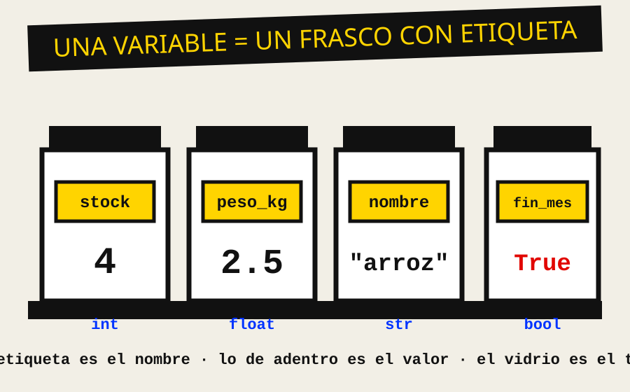
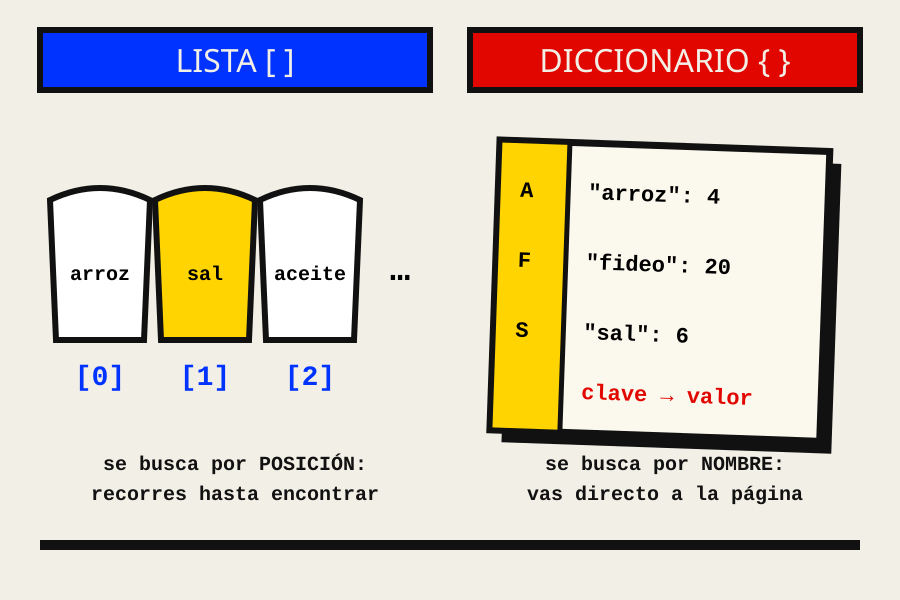

::: {.estilo-capitulo acento="azul" motivo="cuadricula" imagen="../imagenes/cap02/apertura.svg"}
:::

::: {.callout-note collapse="true"}
## Ficha del capítulo
- **Objetivo de aprendizaje:** escribir en Python un programa pequeño y ordenado, con variables, decisiones, ciclos, funciones, listas y diccionarios, y leer sin miedo los mensajes de error.
- **Prerrequisitos:** capítulo 1 (pseudocódigo y prueba de escritorio).
- **Proyecto guía:** **Caserita 0.2**. La regla de reposición pasa del papel a un programa que también registra ventas y decide el fiado.
- **Temas que integra** (del plan original): el primer lenguaje; estructuras de datos básicas; búsqueda y una primera idea de complejidad.
:::

::: {.grito}
La computadora\
no adivina.
:::

En el capítulo 1 aprendiste a pensar el pedido del sábado sin ambigüedad. Ahora vamos a escribirlo para un ejecutor mucho más obediente y mucho menos comprensivo que Marco: la computadora. Ella no adivina, no pregunta y no se cansa. Hace exactamente lo que le dices, ni una coma más. Eso es una maldición y una bendición al mismo tiempo.

| Si llegas hasta el final, podrás… | Lo practicas en… |
|---|---|
| Ejecutar Python y leer lo que responde | @sec-c02-orden |
| Explicar por qué un programa que funciona se vuelve inmanejable | @sec-c02-entropia |
| Usar variables, tipos, decisiones, ciclos, funciones, listas y diccionarios | @sec-c02-analisis |
| Leer un mensaje de error y probar tus funciones con `assert` | @sec-c02-contencion |
| Pedirle a una IA que te explique un error sin que piense por ti | @sec-c02-ia |

: Ruta del capítulo {#tbl-c02-ruta}

## Orden {#sec-c02-orden}

### El lunes en que el cuaderno se volvió pantalla

Marco llega al puesto con una laptop vieja que le prestó su prima. Doña Rosa la mira con desconfianza, como se mira a un casero nuevo.

> —¿Y eso va a saber cuánto aceite pedir?
>
> —No, tía. Eso va a hacer lo que nosotros le digamos. Por eso primero lo escribimos en el cuaderno.

Marco tiene razón, y es la idea central del capítulo: **un lenguaje de programación es una manera de escribir un algoritmo para que una máquina lo ejecute.** El algoritmo ya lo tenemos (es `ReponerPuesto`, del capítulo 1). Lo que nos falta es el idioma.

Elegimos **Python** por tres razones de oficio: se lee casi como el pseudocódigo, se usa en todas partes (desde la web hasta la ciencia de datos y la IA) y su documentación oficial existe en español [@pythontutorial]. Allen Downey, que lleva décadas enseñando a programar con Python, lo resume así: el lenguaje estorba poco, de modo que puedes concentrarte en pensar [@downey2024].

### La primera conversación

Python trae un **intérprete**: un programa que lee tus instrucciones una por una y las ejecuta en el acto. Si abres una terminal y escribes `python`, aparece un indicador `>>>` esperando órdenes:

```python
>>> print("Hola, casera")
Hola, casera
>>> 25 + 12
37
>>> "arroz" * 3
'arrozarrozarroz'
```

Fíjate en la tercera línea. Multiplicar un texto por 3 no tiene sentido en el mercado, pero Python lo hace igual, porque **sus reglas no son las nuestras**. Aprender un lenguaje es aprender sus reglas exactas, incluidas las raras.

::: {.pizarra}
**Pizarra del Inge**

En 1975 yo perforaba tarjetas y esperaba un día entero para saber si mi programa tenía un error. Tú escribes una línea y en un segundo sabes si funciona.

Aprovecha ese lujo: **prueba todo, en pedazos pequeños, todo el tiempo.** El intérprete es tu cuaderno de borrador.
:::

### Del pseudocódigo al programa, palabra por palabra

La buena noticia es que ya sabes más Python del que crees. El vocabulario del libro (@tbl-c01-pseudo) tiene traducción casi directa:

| Pseudocódigo | Python | Qué cambia |
|---|---|---|
| `total ← 0` | `total = 0` | La flecha se vuelve `=` |
| `MOSTRAR total` | `print(total)` | Paréntesis obligatorios |
| `LEER cantidad` | `cantidad = input("¿Cuánto? ")` | `input` siempre devuelve **texto** |
| `SI … ENTONCES … SINO … FIN SI` | `if …:` / `else:` | El bloque se marca con **sangría**, no con `FIN SI` |
| `PARA CADA p EN productos HACER` | `for p in productos:` | Igual, con dos puntos |
| `MIENTRAS … HACER` | `while …:` | Igual, con dos puntos |
| `A Y B`, `A O B`, `NO A` | `a and b`, `a or b`, `not a` | En inglés |

: Diccionario pseudocódigo–Python {#tbl-c02-traduccion}

La sangría merece una advertencia aparte, porque es el primer tropiezo de todos.

::: {.callout-warning}
## Error típico: la sangría
En Python, los espacios al inicio de la línea **son parte del programa**. Lo que está "adentro" de un `if` o de un `for` va corrido cuatro espacios a la derecha. Si mezclas espacios con tabulaciones, o corres una línea de más, el programa cambia de significado o no arranca. La guía de estilo oficial pide cuatro espacios, siempre [@pep8].
:::

## Entropía {#sec-c02-entropia}

### El programa que creció como enredadera

Marco aprende rápido. En una tarde escribe su primer programa del puesto. Funciona. Doña Rosa le pide "que también vea el azúcar", y Marco copia y pega. Luego "que avise si es fin de mes", y Marco agrega otro `if`. Dos semanas después, el archivo se ve así:

```python
arroz_stock = 4
arroz_min = 10
aceite_stock = 3
aceite_min = 6
azucar_stock = 15
azucar_min = 8
# ... 40 líneas más, una pareja por producto ...
if arroz_stock < arroz_min:
    print("pedir arroz 25")
if aceite_stock < aceite_min:
    print("pedir aceite 12")
if azucar_stock < 8:            # alguien escribió el 8 a mano
    print("pedir azucar 50")
```

Nada de esto está "mal": el programa da la respuesta correcta. Pero mira la última condición. Alguien cambió `azucar_min` arriba, a 10, y el programa siguió usando el 8 escrito a mano. **El desorden no rompe el programa de golpe; lo vuelve frágil, un poquito cada día.**

::: {.figura-der ancho="42%"}
{#fig-c02-frascos}

Meir Lehman observó, estudiando sistemas reales durante años, que un programa que se usa **tiene** que cambiar, y que cada cambio aumenta su complejidad a menos que alguien trabaje activamente para reducirla [@lehman1980]. Es la segunda ley de la termodinámica, versión software.

En el programa de Marco, la entropía entra por tres lugares: **repetición** (la misma idea copiada veinte veces), **números mágicos** (el 8 suelto, sin nombre) y **mezcla** (datos, reglas y mensajes revueltos en el mismo lugar).
:::

### Medir el enredo

¿Cuánto trabajo cuesta agregar un producto en cada versión? Contemos.

| Cambio pedido | Versión copiar-pegar | Versión ordenada (la de este capítulo) |
|---|---|---|
| Agregar un producto | 2 variables + 1 `if` + 1 mensaje = 4 lugares | 1 línea en la lista de datos |
| Cambiar la regla de reposición | Tocar 20 `if` (y no olvidarse ninguno) | Tocar 1 función |
| Saber qué productos existen | Leer todo el archivo | Mirar la lista |
| Probar que funciona | Ejecutar y mirar la pantalla | Ejecutar las pruebas automáticas |

: El costo de cambiar, antes y después de ordenar {#tbl-c02-costo}

Con 6 productos, la versión desordenada es molesta. Con 300 (un minimarket), es imposible. Eso es lo que significa que el desorden **escala**: crece más rápido que el sistema.

::: {.recorte}
"Lo explícito es mejor que lo implícito. Lo simple es mejor que lo complejo. La legibilidad cuenta." — fragmentos de *El Zen de Python* [@pep20].
:::

## Análisis {#sec-c02-analisis}

Vamos a construir Caserita 0.2 pieza por pieza. Cada pieza es una herramienta del lenguaje, y cada herramienta resuelve una de las tres entradas del desorden que acabamos de ver.

```{mermaid}
%%| label: fig-c02-mapa
%%| fig-cap: "Las herramientas del capítulo y el desorden que contiene cada una."
flowchart TB
  V[Variables y tipos] --> D[Decisiones]
  D --> C[Ciclos]
  C --> F[Funciones]
  F --> L[Listas y diccionarios]
  V -.->|"da nombre: adiós números mágicos"| X1(( ))
  F -.->|"una sola regla: adiós repetición"| X2(( ))
  L -.->|"los datos aparte: adiós mezcla"| X3(( ))
```

### Variables y tipos: frascos con etiqueta

Una **variable** es un nombre que apunta a un valor. Piensa en un frasco del estante: la etiqueta es el nombre, lo de adentro es el valor, y el tipo de frasco dice qué cosas caben (@fig-c02-frascos).

```python
stock = 4               # int: número entero
peso_kg = 2.5           # float: número con decimales
nombre = "arroz"        # str: texto, siempre entre comillas
es_fin_de_mes = True    # bool: verdadero o falso
```

Los cuatro tipos básicos son suficientes para todo este capítulo:

| Tipo | Ejemplo en el puesto | Operaciones típicas | Cuidado con… |
|---|---|---|---|
| `int` | `stock = 4` | `+ - * //` y comparaciones | `7 // 2` da `3`: división entera |
| `float` | `peso_kg = 2.5` | `+ - * /` | Redondeos raros (ver @sec-c02-custodia) |
| `str` | `nombre = "arroz"` | unir con `+`, `len()`, `.upper()` | `"4" + "4"` da `"44"`, no `8` |
| `bool` | `fin_de_mes = True` | `and`, `or`, `not` | Se escribe con mayúscula: `True`, `False` |

: Los cuatro tipos básicos de Python {#tbl-c02-tipos}

::: {.callout-warning}
## Error típico: `input` devuelve texto
`cantidad = input("¿Cuántos kilos? ")` guarda **texto**, aunque escribas un número. Si luego haces `cantidad + 1`, Python se queja: no sabe sumar texto con números. La solución es convertir: `cantidad = int(input("¿Cuántos kilos? "))`.
:::

**Los nombres importan.** `s = 4` funciona igual que `stock = 4`, pero dentro de seis meses nadie sabrá qué era `s`. La guía de estilo de Python pide nombres en minúsculas, con guion bajo entre palabras: `stock_minimo`, `es_fin_de_mes` [@pep8]. Un buen nombre es la documentación más barata que existe.

### Decisiones: `if`, `elif`, `else`

La lógica del capítulo 1 se escribe con `if`. Cuando hay más de dos caminos, `elif` ("si no, si…") evita escaleras de `if` anidados:

```python
def estado_del_producto(stock, minimo):
    if stock == 0:
        return "AGOTADO"
    elif stock < minimo:
        return "REPONER"
    else:
        return "BIEN"
```

Python revisa las condiciones **de arriba abajo** y se detiene en la primera verdadera. Por eso el orden importa: si pusieras `stock < minimo` primero, un producto agotado (stock 0) diría "REPONER" y nunca "AGOTADO".

### Ciclos: `for` y `while`

El **patrón que se repite** del capítulo 1 se vuelve un ciclo. Python tiene dos:

| Ciclo | Cuándo usarlo | En el puesto |
|---|---|---|
| `for x in coleccion:` | Sabes **sobre qué** vas a repetir | Revisar cada producto del estante |
| `while condicion:` | Repites **hasta que** algo cambie | Atender caseros mientras haya fila |

: Los dos ciclos de Python {#tbl-c02-ciclos}

```python
# for: uno por cada producto
for nombre in ["arroz", "sal", "aceite"]:
    print("Revisando", nombre)

# while: hasta que se acabe la fila
fila = 3
while fila > 0:
    print("Atendiendo, quedan", fila)
    fila = fila - 1          # sin esta línea, el ciclo no termina nunca
```

::: {.callout-warning}
## Error típico: el ciclo infinito
Un `while` cuya condición nunca se vuelve falsa **no termina**. Viola el primer rasgo de Knuth: la finitud (@tbl-c01-rasgos). Antes de escribir un `while`, pregúntate: ¿qué línea de adentro acerca el final?
:::

### Funciones: escribir la regla una sola vez

Una **función** es un algoritmo con nombre: recibe datos (parámetros), hace su trabajo y devuelve un resultado con `return`. Es el antídoto directo contra la repetición: la regla vive en **un** lugar y se usa en cien.

::: {.panel-tabset}

## Pseudocódigo (cap. 1)

```
ALGORITMO NecesitaReponer(producto, es_fin_de_mes)
    falta      ← producto.stock < producto.minimo
    empuje_mes ← es_fin_de_mes Y producto.alta_rotacion
    DEVOLVER falta O empuje_mes
FIN
```

## Python

```python
def necesita_reponer(producto, es_fin_de_mes):
    falta = producto["stock"] < producto["minimo"]
    empuje_mes = es_fin_de_mes and producto["alta_rotacion"]
    return falta or empuje_mes
```

## Uso

```python
>>> arroz = {"stock": 4, "minimo": 10, "alta_rotacion": True}
>>> necesita_reponer(arroz, es_fin_de_mes=False)
True
```

:::

::: {.pizarra}
**Pizarra del Inge**

Una función buena cabe en la pantalla, hace **una sola cosa** y su nombre dice cuál. Si para explicar lo que hace necesitas la palabra "y" (*calcula el pedido **y** lo imprime **y** lo guarda*), son tres funciones disfrazadas de una.
:::

### Colecciones: listas y diccionarios

Aquí está la cura de la mezcla: **separar los datos de las reglas**. Python trae dos colecciones que usarás todos los días.

::: {.figura-izq ancho="44%"}
{#fig-c02-colecciones}

Una **lista** es una fila ordenada de valores, como los sacos alineados en el piso del puesto. Cada uno tiene una posición, que empieza en **cero**: `productos[0]` es el primero.

Un **diccionario** es como el cuaderno de Doña Rosa con su índice de letras: guardas cada valor bajo una **clave** (un nombre) y lo recuperas directo, sin recorrer todo: `stock["aceite"]`.
:::

```python
sacos = ["arroz", "sal", "aceite"]        # lista: por posición
print(sacos[0])                           # arroz
sacos.append("fideo")                     # agregar al final

stock = {"arroz": 4, "sal": 6, "aceite": 3}   # diccionario: por clave
print(stock["aceite"])                        # 3
stock["aceite"] = stock["aceite"] + 12        # llegó el pedido
```

¿Cuál conviene? Depende de **cómo vas a buscar**. Y aquí aparece, por primera vez, una idea que te acompañará toda la carrera: el costo de buscar.

| Pregunta | Con una lista | Con un diccionario |
|---|---|---|
| ¿Cuánto aceite hay? | Recorrer producto por producto hasta encontrarlo | Ir directo: `stock["aceite"]` |
| Pasos con 6 productos | Hasta 6 | 1 |
| Pasos con 3000 productos | Hasta 3000 | 1, en promedio |
| Se dice que el costo es… | $O(n)$: crece con la cantidad | $O(1)$: no crece |

: Buscar en una lista o en un diccionario {#tbl-c02-busqueda}

La notación $O(n)$ ("o de ene") es la manera que tiene el oficio de decir **cómo crece el trabajo cuando crecen los datos**. No te preocupes por la teoría todavía: quédate con la intuición de que un diccionario es un índice, y un índice ahorra caminar.

### Caserita 0.2: todo junto

Ahora sí. Este es el programa completo del puesto, con las tres curas aplicadas: nombres claros, una función por regla y los datos aparte.

```{#lst-c02-caserita .python lst-cap="Caserita, versión 0.2: inventario, reposición, ventas y fiado"}
STOCK_MINIMO_DEFECTO = 5                                      # <1>
LIMITE_FIADO_CENTAVOS = 10_000          # 100 Bs              # <2>

productos = {                                                 # <3>
    "arroz":  {"stock": 4,  "minimo": 10, "lote": 25, "alta_rotacion": True},
    "sal":    {"stock": 6,  "minimo": 5,  "lote": 10, "alta_rotacion": False},
    "aceite": {"stock": 3,  "minimo": 6,  "lote": 12, "alta_rotacion": True},
    "fideo":  {"stock": 20, "minimo": 8,  "lote": 20, "alta_rotacion": True},
}

def necesita_reponer(producto, es_fin_de_mes):                # <4>
    falta = producto["stock"] < producto["minimo"]
    empuje_mes = es_fin_de_mes and producto["alta_rotacion"]
    return falta or empuje_mes

def armar_pedido(productos, es_fin_de_mes):
    pedido = []
    for nombre, datos in productos.items():                   # <5>
        if necesita_reponer(datos, es_fin_de_mes):
            pedido.append((nombre, datos["lote"]))
    return pedido

def registrar_venta(productos, nombre, cantidad):
    if nombre not in productos:                               # <6>
        raise ValueError(f"No vendemos {nombre}")
    if cantidad > productos[nombre]["stock"]:
        raise ValueError(f"Solo quedan {productos[nombre]['stock']} de {nombre}")
    productos[nombre]["stock"] -= cantidad

def puede_fiar(deuda_centavos, dias_de_deuda):
    return deuda_centavos < LIMITE_FIADO_CENTAVOS and dias_de_deuda < 15

registrar_venta(productos, "fideo", 13)
print(armar_pedido(productos, es_fin_de_mes=False))
# [('arroz', 25), ('aceite', 12)]
```
1. Una **constante**: un valor con nombre, en mayúsculas por convención. Adiós número mágico.
2. El dinero se guarda en **centavos enteros**. La razón está en la @sec-c02-custodia. El `_` en `10_000` es solo para leer mejor.
3. Los **datos aparte**: un diccionario cuyas claves son los nombres y cuyos valores son otros diccionarios. Agregar un producto es agregar una línea.
4. La regla del capítulo 1, escrita **una sola vez**.
5. `.items()` entrega cada clave con su valor, en parejas.
6. Validar antes de actuar: si algo está mal, el programa lo dice **en voz alta** en vez de seguir con datos falsos.

Fíjate que, después de vender 13 de fideo, el stock baja de 20 a 7, que es menos que su mínimo (8). ¿Por qué entonces el fideo no aparece en el pedido? **Haz la prueba de escritorio antes de seguir leyendo.** (Respuesta: sí debería aparecer. Si ejecutas el programa, verás `[('arroz', 25), ('aceite', 12), ('fideo', 20)]`; el comentario del código está desactualizado. Los comentarios también se pudren, y es una de las formas más silenciosas de entropía.)

```{mermaid}
%%| label: fig-c02-flujo
%%| fig-cap: "Cómo fluye una venta en Caserita 0.2."
flowchart TD
  A([Venta: fideo x 13]) --> B{¿Existe el producto?}
  B -- No --> E1[/Error: No vendemos eso/]
  B -- Sí --> C{¿Alcanza el stock?}
  C -- No --> E2[/Error: Solo quedan N/]
  C -- Sí --> D[stock ← stock − cantidad]
  D --> P[armar_pedido revisa todo el estante]
  P --> R[/Pedido del sábado/]
```

## Contención {#sec-c02-contencion}

::: {.manifiesto}
1. Ningún número suelto: todo valor importante lleva nombre.
2. Ninguna regla copiada: si la escribes dos veces, es una función.
3. Ningún dato mezclado con la lógica: los datos van aparte.
4. Ninguna función sin una prueba que la ejecute.
5. Ningún error ignorado: se lee completo, de abajo hacia arriba.
:::

### Leer un error sin miedo

Cuando algo falla, Python escribe un **traceback**: el rastro de lo que estaba haciendo. Asusta, pero se lee fácil si sabes dónde mirar.

```python
>>> registrar_venta(productos, "azucar", 2)
Traceback (most recent call last):
  File "caserita.py", line 31, in <module>
    registrar_venta(productos, "azucar", 2)
  File "caserita.py", line 21, in registrar_venta
    raise ValueError(f"No vendemos {nombre}")
ValueError: No vendemos azucar
```

| Parte del mensaje | Qué te dice |
|---|---|
| Última línea: `ValueError: No vendemos azucar` | **Qué** pasó. Empieza siempre por aquí |
| `line 21, in registrar_venta` | **Dónde** pasó |
| Las líneas de arriba | **Cómo se llegó** hasta ahí, llamada por llamada |

: Cómo leer un traceback, de abajo hacia arriba {#tbl-c02-traceback}

### Pruebas con `assert`: la prueba de escritorio, automatizada

En el capítulo 1 hiciste la prueba de escritorio a mano. Ahora la máquina la puede repetir cada vez que cambies algo. `assert` comprueba una condición y grita si no se cumple:

```python
def probar_necesita_reponer():
    arroz = {"stock": 4, "minimo": 10, "alta_rotacion": True}
    sal = {"stock": 5, "minimo": 5, "alta_rotacion": False}
    assert necesita_reponer(arroz, False) is True      # falta
    assert necesita_reponer(sal, False) is False       # caso borde: justo en el mínimo
    assert necesita_reponer(sal, True) is False        # fin de mes, pero rota poco
    print("Todo bien")

probar_necesita_reponer()
```

Cada fila de tu prueba de escritorio (@tbl-c01-escritorio) se convierte en un `assert`. Si mañana alguien "mejora" la regla y rompe un caso, la prueba lo detecta antes que Doña Rosa. En el capítulo 5 convertiremos esto en un sistema de pruebas completo.

::: {.callout-important}
## Reto: Caserita aprende a fiar

Toma el algoritmo `DecidirFiado` que escribiste en el reto del capítulo 1 y conviértelo en Python.

1. Crea un diccionario `caseros` con al menos cinco personas (inventadas). De cada una guarda: deuda en **centavos**, días desde la última deuda y si es casero de confianza.
2. Escribe la función `puede_fiar(casero)` que aplique **tu** regla. Nada de números mágicos: usa constantes.
3. Escribe `registrar_fiado(caseros, nombre, monto_centavos)`, que rechace con `ValueError` si la regla no lo permite.
4. Escribe una función de prueba con al menos **seis** `assert`, dos de ellos en casos borde (deuda exactamente en el límite, días exactamente en el límite).

**Criterio de logro:** tu programa corre sin errores, todas tus pruebas pasan y otra persona puede cambiar el límite de deuda tocando **una sola línea**.
:::

## Ojo de la IA {#sec-c02-ia}

::: {.callout-tip icon="false"}
## Ojo de la IA
Cuando aprendes tu primer lenguaje, una IA puede ser una tutora con paciencia infinita: le pegas un traceback y te lo explica; le pides que te muestre tres maneras de recorrer un diccionario y lo hace. Úsala así.

El riesgo está en el otro uso: pedirle el programa entero. Te entregará algo que funciona, con herramientas que todavía no conoces (`lambda`, comprensiones de listas, clases), y tendrás un programa **que no puedes mantener**. Es la entropía de Lehman, pero desde el primer día.

| Pídele… | Mejor que… |
|---|---|
| "Explícame este error línea por línea" | "Arréglame el código" |
| "¿Qué hace `.items()`? Dame un ejemplo con productos de un puesto" | "Escribe el programa del inventario" |
| "Revisa si mi función tiene algún caso borde que no probé" | "Escribe las pruebas por mí" |

**Lo que debe revisar una persona:** que cada línea que entra a tu programa la puedas explicar en voz alta. Si no puedes, todavía no es tuya.
:::

## Custodia {#sec-c02-custodia}

::: {.figura-pie lado="izq" ancho="62%"}
{#fig-c02-centavos}
:::

Prueba esto en el intérprete:

```python
>>> 0.1 + 0.2
0.30000000000000004
```

No es un error de Python. Las computadoras guardan los números con decimales en binario, y $0.1$ no tiene representación exacta en binario, igual que $1/3$ no la tiene en decimal ($0.3333…$). Para medir el peso de un saco da igual. **Para el dinero de la gente, no.** Un centavo de diferencia por venta, en miles de ventas, es una cuenta que no cuadra y una casera acusada de un faltante que nunca existió.

::: {.callout-warning icon="false"}
## Custodia
El tipo de dato que eliges es una decisión con consecuencias para personas reales.

- El dinero se guarda en **centavos enteros** (`int`) o con el tipo `Decimal` de Python, nunca con `float`.
- Un nombre de variable engañoso (`total` que en realidad es el subtotal sin descuento) es una mentira escrita que alguien va a creer.
- Cuando tu programa rechaza una venta o un fiado, debe decir **por qué**, con palabras que entienda quien atiende el puesto.

Programar con cuidado también es una forma de respeto.
:::

## Para cerrar

::: {.pizarra}
**Pizarra del Inge: lo que te llevas**

- Un lenguaje es un idioma para escribir algoritmos. Python se parece al pseudocódigo: aprovéchalo.
- Variables con **buen nombre**, cuatro tipos básicos y la sangría como parte del programa.
- `if/elif/else` para decidir, `for` para recorrer, `while` para repetir hasta que algo cambie.
- **Funciones** contra la repetición; **listas y diccionarios** para separar datos de reglas.
- El error se lee de abajo hacia arriba. Cada prueba de escritorio se vuelve un `assert`.
:::

**Preguntas de repaso**

1. ¿Qué tres fuentes de desorden tenía el programa de copiar y pegar de Marco, y qué herramienta del capítulo cura cada una?
2. ¿Por qué conviene un diccionario y no una lista para consultar el stock de un producto por su nombre?
3. ¿Por qué Caserita guarda el límite de fiado como `10_000` y no como `100.0`?

**Para profundizar**

- Downey, *Think Python* [@downey2024]: el libro de introducción más claro para empezar con Python.
- *El tutorial de Python*, en español [@pythontutorial]: la fuente oficial, para tener siempre a mano.
- *PEP 8* [@pep8] y *El Zen de Python* [@pep20]: cómo escribe la comunidad y por qué.
- Lehman [@lehman1980]: las leyes que explican por qué el código de Marco se enredó.

| Palabra | En una línea |
|---|---|
| Intérprete | Programa que lee y ejecuta tus instrucciones una por una |
| Variable | Nombre que apunta a un valor |
| Tipo | La clase de valor: entero, decimal, texto o verdadero/falso |
| Función | Algoritmo con nombre que recibe datos y devuelve un resultado |
| Lista | Colección ordenada que se consulta por posición |
| Diccionario | Colección que se consulta por clave |
| Traceback | Rastro que deja Python cuando algo falla |
| `assert` | Comprobación que detiene el programa si una condición no se cumple |

: Glosario del capítulo {#tbl-c02-glosario}

::: {.callout-note appearance="minimal"}
**Caserita, versión 0.2:** un programa en Python que arma el pedido, registra ventas y decide el fiado, con sus propias pruebas. En el capítulo 3 aprenderá a ordenarse en módulos y a recordar todo en una base de datos.
:::
