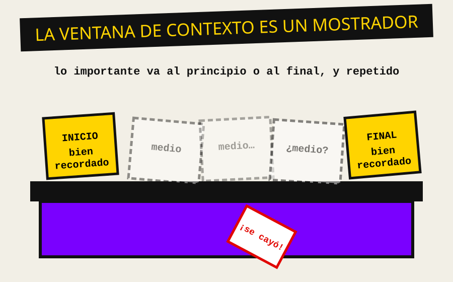
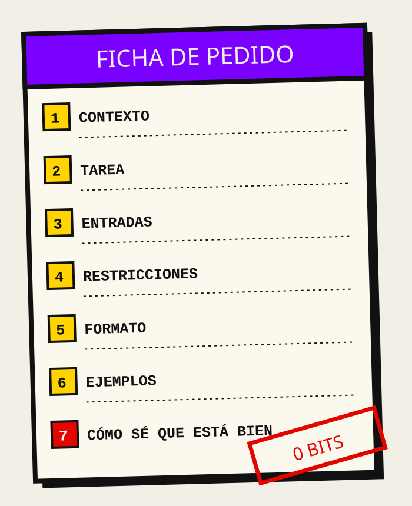
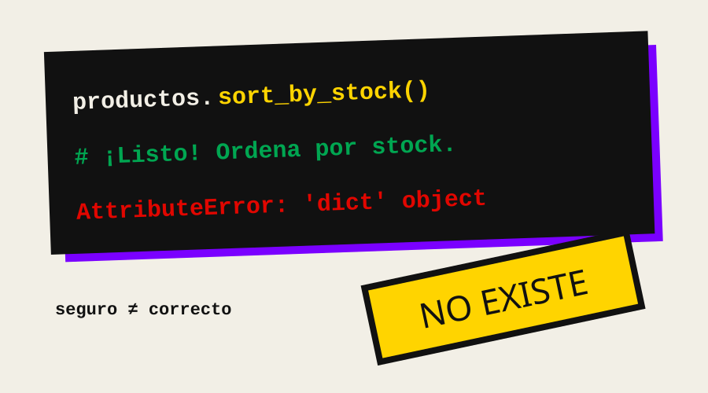

::: {.estilo-capitulo acento="violeta" motivo="puntos" imagen="../imagenes/cap07/apertura.svg"}
:::

::: {.callout-note collapse="true"}
## Ficha del capítulo
- **Objetivo de aprendizaje:** escribir especificaciones que una IA pueda ejecutar sin adivinar, trabajar con ella en ciclos cortos de pedir, verificar y corregir, y decidir qué no se le debe delegar.
- **Prerrequisitos:** capítulos 1 y 2 (pseudocódigo, pruebas con `assert`), y el capítulo 6 (qué es un token y qué es la ventana de contexto).
- **Proyecto guía:** empieza **Caserita 2.0**. Con ayuda de una IA construimos el **reporte semanal del puesto**: qué se vendió, qué falta y quién debe.
- **Temas que integra** (del plan original): comunicarse con la máquina; proyecto guía con IA.
:::

::: {.grito}
Un prompt\
es un requisito\
con prisa.
:::

En el capítulo 1 conociste a Marco, que volvió con cincuenta kilos de sal porque nadie le dijo qué era "poco". Ahora tienes un ayudante nuevo que trabaja mil veces más rápido que Marco, nunca se cansa, escribe código impecable… y tiene exactamente el mismo problema: **si no le dices qué es "poco", lo inventa.** Este capítulo trata de cómo hablarle para que no tenga que inventar.

| Si llegas hasta el final, podrás… | Lo practicas en… |
|---|---|
| Ver un prompt como lo que es: una especificación | @sec-c07-orden |
| Explicar por qué un pedido vago produce respuestas genéricas o falsas | @sec-c07-entropia |
| Escribir una ficha de pedido en siete partes e iterar sobre ella | @sec-c07-analisis |
| Verificar lo que la IA entrega con pruebas escritas **antes** | @sec-c07-contencion |
| Reconocer cuándo no delegar | @sec-c07-custodia |

: Ruta del capítulo {#tbl-c07-ruta}

## Orden {#sec-c07-orden}

### Antes de la máquina ya había pedidos

Mucho antes de que existiera la IA, el oficio de programar ya tenía un nombre para "explicarle a otro qué construir": **especificación**. Un cliente le dice a un equipo qué necesita, el equipo lo escribe, lo discute, lo corrige, y recién entonces programa. Cuando ese documento es bueno, cualquier persona del equipo construye lo mismo. Cuando es malo, cada uno construye lo que se imaginó.

Doña Rosa, después del episodio de la sal, aprendió por su cuenta. Ahora, cuando manda a Marco donde el mayorista, le da una **ficha**:

::: {.recorte}
Mayorista Don Teo. Domingo antes de las 8.\
Arroz: 1 quintal, del grano largo, no del partido.\
Aceite: 12 botellas de litro. Si no hay de la marca de siempre, la otra, pero NO bidón.\
Pagar al contado; pedir boleta. Si sube más de 10 % algo, llamarme antes de comprar.
:::

Mira lo que hay en esa ficha: **qué** comprar, **cuánto**, **qué variante**, **qué hacer si algo falla** y **cuándo detenerse a preguntar**. Doña Rosa no escribió un prompt. Escribió una especificación. Y es exactamente lo que necesita una IA.

::: {.pizarra}
**Pizarra del Inge**

Un **prompt** es el texto que le das a un modelo de lenguaje. Una **especificación** es un documento que describe qué debe hacer un sistema, sin ambigüedad.

En mi oficio, un buen prompt es una especificación corta. Un mal prompt es un deseo.
:::

### Qué recibe realmente el modelo

En el capítulo 6 viste cómo funciona un modelo de lenguaje: recibe texto convertido en **tokens**, mira todo lo que cabe en su **ventana de contexto** y predice, token por token, la continuación más probable [@vaswani2017; @brown2020]. De ahí salen tres consecuencias prácticas que gobiernan todo este capítulo:

| Lo que el modelo es | Consecuencia práctica | Qué haces tú |
|---|---|---|
| Un predictor de la continuación **más probable** | Ante la duda, elige lo **típico**, no lo tuyo | Darle lo particular: datos, reglas, ejemplos |
| Alguien que **solo sabe lo que hay en su contexto** | No conoce a Doña Rosa, ni tu código, ni tus reglas | Poner en el contexto todo lo que necesita |
| Un sistema que **no sabe que no sabe** | Rellena los huecos con seguridad | Pedirle que pregunte o que marque lo que supone |

: Tres hechos del modelo y lo que implican para quien le escribe {#tbl-c07-hechos}

## Entropía {#sec-c07-entropia}

### El sistema de un puesto cualquiera

Marco, entusiasmado, escribe en un chat de IA:

```
Hazme el sistema de mi puesto.
```

En treinta segundos recibe 300 líneas de código: una clase `Producto` con `precio`, `categoria` y `codigo_barras`, un menú de consola, una función de facturación con IVA… Funciona. Y no sirve para nada. No sabe del fiado, no sabe del fin de mes, no sabe que el aceite se vende en un día. **Es el sistema del puesto promedio de internet, no el del puesto 47.**

No es un defecto de la IA: es exactamente lo que se le pidió. El modelo se entrena para minimizar la **entropía cruzada**, es decir, para que la continuación que predice se parezca lo más posible a lo que suele venir después en sus datos [@brown2020]. Ante un pedido vago, lo más probable es lo más común. Lo particular (lo tuyo) es, por definición, lo improbable.

```{mermaid}
%%| label: fig-c07-hueco
%%| fig-cap: "Cada hueco del pedido se rellena con lo más probable, no con lo correcto."
flowchart TB
  P["Pedido vago: hazme el sistema"] --> H{"¿Qué es poco? ¿Hay fiado?"}
  H -->|"el modelo no pregunta"| T[Rellena con lo típico]
  T --> R1[Código que funciona]
  R1 --> R2[...para un puesto que no existe]
  H -->|"tú respondes antes"| E[Especificación]
  E --> R3[Código para el puesto 47]
```

### Las tres formas del desorden con IA

La ambigüedad del capítulo 1 sigue ahí, pero con la IA aparece amplificada y con disfraz. Reconoce sus tres formas:

| Forma | Cómo se ve | Por qué pasa | Evidencia |
|---|---|---|---|
| **Lo genérico** | Respuesta correcta para otro problema | Rellena huecos con lo típico | Lo viste arriba |
| **La alucinación** | Afirma algo falso con total seguridad: una función, una cifra, una cita que no existe | Predice texto plausible, no verifica hechos | Revisión de @ji2023 |
| **El olvido del medio** | Ignora una regla que sí le diste, porque estaba enterrada en un texto largo | Usa peor la información del centro de contextos largos | Experimentos de @liu2024lost |

: Tres formas del desorden al trabajar con IA {#tbl-c07-desorden}

::: {.figura-der ancho="44%"}
{#fig-c07-mostrador}

La tercera forma sorprende a todos. Un grupo de investigadores de Stanford y otras instituciones colocó la información clave en distintas posiciones de un texto largo y midió cuánto la usaban los modelos: el rendimiento era mejor cuando el dato estaba **al principio o al final**, y caía cuando estaba en el medio [@liu2024lost].

Para ti, la lección es de mostrador: lo importante va arriba, lo repites al final, y no entierras la regla del fiado entre doscientas líneas de código pegado "por si acaso".
:::

Y hay una cuarta forma, la más peligrosa, que no está en la IA sino en nosotros: **la confianza**. En un experimento con estudiantes y profesionales, quienes usaron un asistente de IA escribieron código **menos seguro** que quienes no lo usaron, y a la vez estaban **más convencidos** de que su código era seguro [@perry2023]. El desorden que no se ve es el que más crece.

::: {.pizarra}
**Pizarra del Inge**

Marco se equivocaba y dudaba. La máquina se equivoca y **no duda**. Eso no la hace peor que Marco; la hace distinta. Con Marco revisabas cuando lo veías dudar. Con la máquina revisas **siempre**.
:::

## Análisis {#sec-c07-analisis}

### La ficha de pedido: siete partes

Volvamos a la ficha de Doña Rosa y hagámosla general. Una especificación para una IA tiene siete partes. No todas son obligatorias en cada pedido, pero conviene que sepas que existen para decidir cuáles omitir.

::: {.figura-izq ancho="38%"}
{#fig-c07-ficha}

1. **Contexto:** quién eres, qué es el proyecto, qué existe ya.
2. **Tarea:** qué hay que hacer, en una frase con verbo.
3. **Entradas:** qué datos recibe, con su forma exacta.
4. **Restricciones:** qué está prohibido o es obligatorio (lenguaje, librerías, estilo, dinero en centavos).
5. **Formato de salida:** qué debe devolver y cómo.
6. **Ejemplos:** uno o dos casos resueltos. Los modelos aprenden mucho de muy pocos ejemplos dentro del pedido [@brown2020].
7. **Criterios de aceptación:** cómo sabrás que está bien. Idealmente, **pruebas**.
:::

Es la misma receta que recomiendan las guías de los fabricantes de modelos: ser claro y directo, dar contexto, mostrar ejemplos y dividir lo complejo en pasos [@anthropicprompt]. No es magia: es la ingeniería de requisitos de toda la vida, comprimida.

### De pedido vago a ficha, en tres versiones

Construyamos el **reporte semanal** de Caserita 2.0. Doña Rosa quiere, cada sábado, un resumen de qué se vendió, qué hay que reponer y quién debe más de lo prudente.

::: {.panel-tabset}

## Versión 1: el deseo

```
Hazme un reporte semanal para mi tienda.
```

Incertidumbre altísima. ¿Reporte de qué? ¿En qué formato? ¿Con qué datos? El modelo inventará una tienda, unas columnas y un formato. Recibirás algo bonito e inútil.

## Versión 2: con contexto y tarea

```
Tengo un puesto de abarrotes. Mi programa en Python guarda los productos
en un diccionario. Escribe una función que genere un reporte semanal con
las ventas, lo que hay que reponer y los fiados.
```

Mejor: ya sabe el lenguaje y el tema. Pero ¿cómo es el diccionario? ¿Qué es "reponer"? ¿Qué fiados importan? Todavía adivina en cuatro o cinco lugares.

## Versión 3: la ficha

````
CONTEXTO: Caserita, sistema de un puesto de abarrotes en un mercado de Bolivia.
Ya existen estas funciones (no las reescribas):
  necesita_reponer(producto, es_fin_de_mes) -> bool
  armar_pedido(productos, es_fin_de_mes) -> list[tuple[str, int]]

TAREA: escribe reporte_semanal(productos, ventas, caseros, es_fin_de_mes) -> str

ENTRADAS:
- productos: dict nombre -> {"stock", "minimo", "lote", "alta_rotacion"}
- ventas: list de (nombre_producto, cantidad)
- caseros: dict nombre -> {"deuda_centavos": int, "dias_de_deuda": int}

RESTRICCIONES:
- Python 3 estándar, sin librerías externas.
- El dinero está en centavos (int). Muéstralo en Bs con dos decimales SOLO al imprimir.
- No cambies las funciones existentes.

FORMATO: texto plano con tres secciones: VENDIDO, REPONER, FIADOS A REVISAR.
"Fiados a revisar" = deuda >= 10000 centavos O dias_de_deuda >= 15.

EJEMPLO: con ventas [("arroz", 3), ("arroz", 2)] la sección VENDIDO dice "arroz: 5".

ACEPTACIÓN: debe pasar estas pruebas (no las modifiques):
  assert "arroz: 5" in reporte
  assert "Bs 120.50" in reporte   # casero con deuda 12050

Si algo de esta ficha es ambiguo, PREGÚNTAME antes de escribir código.
````

:::

Fíjate en la última línea de la versión 3. Es la instrucción más valiosa de todas: **le da permiso de preguntar.** Por defecto, el modelo prefiere responder antes que preguntar; si se lo pides, a menudo encuentra la ambigüedad que tú no viste.

| Versión | Partes de la ficha presentes | Huecos que el modelo rellena | Probabilidad de que sirva tal cual |
|---|---|---|---|
| 1. El deseo | 1 de 7 (una tarea vaga) | Casi todos | Muy baja |
| 2. Contexto y tarea | 3 de 7 | Forma de los datos, reglas, formato | Baja |
| 3. La ficha | 7 de 7 | Ninguno conocido (y puede preguntar) | Alta, **y verificable** |

: Tres versiones del mismo pedido {#tbl-c07-versiones}

### Pensar en voz alta, por pasos

Cuando el problema tiene varios pasos de razonamiento (calcular, comparar, decidir), sirve pedirle al modelo que **razone paso a paso** antes de dar la respuesta final. Un trabajo muy citado mostró que dar ejemplos con el razonamiento intermedio escrito mejora de forma notable el desempeño de modelos grandes en problemas de aritmética y lógica [@wei2022].

Para ti, esto tiene una ventaja extra: si el razonamiento está escrito, **puedes auditarlo**. Es la prueba de escritorio del capítulo 1, pero hecha por la máquina y revisada por ti.

### El ciclo corto: pedir, verificar, corregir

Nadie escribe la ficha perfecta a la primera, igual que nadie escribe el pseudocódigo perfecto a la primera (recuerda las cuatro pasadas del capítulo 1). Con IA se trabaja en **ciclos cortos**:

```{mermaid}
%%| label: fig-c07-ciclo
%%| fig-cap: "El ciclo corto de trabajo con IA: cada vuelta reduce la incertidumbre."
flowchart TD
  A["Paso 1: Escribir las pruebas"] --> B["Paso 2: Escribir la ficha"]
  B --> C["Paso 3: Pedir una pieza pequeña"]
  C --> D["Paso 4: Leer y ejecutar las pruebas"]
  D -->|fallan o no entiendo| E["Paso 5: Corregir la ficha, no solo el código"]
  E --> C
  D -->|pasan y lo entiendo| F["Paso 6: Guardar en Git y pasar a la siguiente pieza"]
```

Dos reglas hacen que el ciclo funcione:

- **Piezas pequeñas.** Una función por vuelta, no un sistema. Lo pequeño se puede leer; lo grande solo se puede creer.
- **Corregir la ficha, no solo el código.** Si el modelo se equivocó, casi siempre es porque la ficha tenía un hueco. Tapa el hueco en la ficha, porque esa ficha es tu documentación y la vas a reutilizar.

### La ficha como archivo del proyecto

En proyectos reales, la ficha deja de vivir en el chat y pasa a ser un archivo del repositorio, por ejemplo `ESPECIFICACION.md`. Así la versionas con Git (capítulo 4), la comparte todo el equipo y se la puedes dar a cualquier herramienta de IA como contexto. La especificación se vuelve **el contrato** entre las personas, el código y la máquina.

## Contención {#sec-c07-contencion}

::: {.manifiesto}
1. Ninguna petición sin pruebas escritas antes.
2. Ninguna pieza más grande de lo que puedes leer en cinco minutos.
3. Ninguna regla del negocio que no esté escrita en la ficha.
4. Ninguna línea aceptada que no puedas explicar.
5. Ninguna corrección solo en el código: se corrige también la ficha.
:::

### Las pruebas van primero

En el capítulo 2 aprendiste a escribir `assert`. Aquí se vuelven tu arma principal. Antes de pedirle nada a la IA, escribe las pruebas con **tus** casos (los de tu prueba de escritorio y tus casos borde). Así la IA no puede "aprobar su propio examen": el examen lo pusiste tú.

```python
def probar_reporte():
    productos = {"arroz": {"stock": 4, "minimo": 10, "lote": 25, "alta_rotacion": True}}
    ventas = [("arroz", 3), ("arroz", 2)]
    caseros = {
        "Don Lucho": {"deuda_centavos": 12050, "dias_de_deuda": 3},     # <1>
        "Doña Eva":  {"deuda_centavos": 2000,  "dias_de_deuda": 15},    # <2>
        "Rubén":     {"deuda_centavos": 9999,  "dias_de_deuda": 14},    # <3>
    }
    reporte = reporte_semanal(productos, ventas, caseros, es_fin_de_mes=False)
    assert "arroz: 5" in reporte
    assert "Bs 120.50" in reporte
    assert "Doña Eva" in reporte
    assert "Rubén" not in reporte
```
1. Deuda alta: debe aparecer, y el monto debe mostrarse bien convertido a bolivianos.
2. Caso borde de días: exactamente 15, debe aparecer.
3. Caso borde doble: justo por debajo de ambos límites, **no** debe aparecer.

### Lista de revisión de lo que entrega la IA

| Revisa | Pregunta | Por qué |
|---|---|---|
| Existencia | ¿Cada función y librería que usa existe de verdad? | Alucinaciones de API (@fig-c07-invento) |
| Reglas | ¿Respeta **todas** las reglas de la ficha, también las del medio? | Olvido del medio [@liu2024lost] |
| Datos | ¿Usa los tipos que pediste (centavos en `int`)? | Lo típico gana sobre lo tuyo |
| Alcance | ¿Cambió algo que no le pediste? | Los modelos "mejoran" de más |
| Seguridad | ¿Mete datos de usuario en algún lugar peligroso? | Exceso de confianza [@perry2023] |
| Comprensión | ¿Puedes explicar cada línea? | Si no, todavía no es tuya |

: Lista de revisión del código generado {#tbl-c07-revision}

::: {.callout-important}
## Reto: el reporte semanal, con ficha y sin trampa

1. Escribe primero la función `probar_reporte()` con al menos **seis** `assert`, dos de ellos en casos borde que **no** aparezcan en este capítulo.
2. Escribe tu ficha de pedido completa (las siete partes) para `reporte_semanal`, guardada como `ESPECIFICACION.md`.
3. Pídele la función a una IA. Ejecuta tus pruebas.
4. Lleva una **bitácora**: cuántas vueltas del ciclo necesitaste, qué hueco de la ficha causó cada error y cómo la corregiste.
5. Al final, explica en voz alta (o por escrito) cada línea del código aceptado.

**Criterio de logro:** las pruebas pasan, la bitácora muestra al menos una corrección **de la ficha** (no solo del código) y puedes explicar el código completo sin mirar la conversación con la IA.
:::

## Ojo de la IA {#sec-c07-ia}

::: {.callout-tip icon="false"}
## Ojo de la IA
En esta parte del libro, el ojo de la IA es el tema central. Miremos de cerca una respuesta realista a la versión 2 del pedido (la de contexto y tarea, sin ficha completa), y revisémosla con la @tbl-c07-revision.

```python
def reporte_semanal(productos, ventas, caseros):
    vendidos = {}
    for nombre, cantidad in ventas:
        vendidos[nombre] = vendidos.get(nombre, 0) + cantidad
    texto = "VENDIDO\n"
    for nombre, total in vendidos.items():
        texto += f"{nombre}: {total}\n"
    texto += "REPONER\n"
    for nombre in productos.sort_by_stock():             # <1>
        ...
    texto += "FIADOS\n"
    for nombre, c in caseros.items():
        if c["deuda"] > 100.0:                           # <2>
            texto += f"{nombre}: Bs {c['deuda']:.2f}\n"
    return texto
```
1. **Alucinación:** los diccionarios de Python no tienen `sort_by_stock()`. El código se ve perfecto y falla al ejecutarse.
2. **Lo típico sobre lo tuyo:** usa `float` para el dinero, inventa la clave `"deuda"` (la tuya era `deuda_centavos`) y olvida la regla de los días. Además, ignora `es_fin_de_mes` y la función `armar_pedido` que ya existía.

::: {.figura-pie lado="der" ancho="58%"}
{#fig-c07-invento}
:::

Nada de esto lo detecta un vistazo rápido. **Lo detectan tus pruebas.** Las cuatro fallarían, cada una por una razón distinta, y cada falla te señala un hueco de la ficha.

| Con este tema, la IA… | Ayuda | Se equivoca |
|---|---|---|
| Convertir una ficha precisa en código | Muchísimo: es su mejor uso | Poco, si la ficha y las pruebas son buenas |
| Encontrar ambigüedades en tu ficha | Bastante, si le pides que pregunte | Puede inventar dudas irrelevantes |
| Proponer casos borde | Bastante | Nunca reemplaza los que conoces del negocio |
| Saber las reglas del puesto | Nada | Siempre que no están escritas |
| Decirte si su propio código está bien | Poco: tiende a aprobarse | Con frecuencia, y con seguridad |
:::

## Custodia {#sec-c07-custodia}

::: {.callout-warning icon="false"}
## Custodia
En la Parte II, la custodia responde una pregunta concreta: **¿cuándo no delegar?** Estas son las señales de que una tarea no se le pasa a la IA, o no completa:

- **Cuando no puedes verificar el resultado.** Si no sabes cómo comprobar que está bien, no tienes un ayudante: tienes un oráculo. Primero aprende a verificar.
- **Cuando el pedido lleva datos de personas.** La lista de deudores de Doña Rosa, con nombres y montos, no se pega en un chat de un servicio externo. Usa datos inventados o anonimizados para pedir el código; los datos reales se quedan en el puesto. (En el capítulo 11 veremos por qué esto es también un asunto de soberanía.)
- **Cuando la tarea es decidir sobre personas.** La IA puede escribir la función `puede_fiar`; **el límite de fiado lo decide Doña Rosa**, y la responsabilidad de esa regla es de quien la pone en el sistema.
- **Cuando estás aprendiendo eso mismo.** Si el objetivo es que *tú* aprendas a recorrer un diccionario, delegarlo es saltarte la clase.

Quien firma el commit responde por el código, lo haya escrito una persona o una máquina.
:::

## Para cerrar

::: {.pizarra}
**Pizarra del Inge: lo que te llevas**

- Un prompt es una **especificación corta**. La IA predice lo más probable; lo tuyo hay que escribirlo.
- Tres desórdenes: **lo genérico**, **la alucinación** y **el olvido del medio**. Y uno más, en ti: la confianza.
- La ficha de siete partes: contexto, tarea, entradas, restricciones, formato, ejemplos y aceptación.
- Ciclo corto: **pruebas primero**, piezas pequeñas, corregir la ficha y no solo el código.
- No se delega lo que no puedes verificar, los datos de personas ni las decisiones sobre ellas.
:::

**Preguntas de repaso**

1. ¿Por qué un modelo entrenado con entropía cruzada tiende a dar una respuesta genérica ante un pedido vago?
2. En la versión 3 del pedido, ¿qué parte de la ficha evitaría el error del `float` del Ojo de la IA? ¿Y cuál el de `sort_by_stock()`?
3. Da un ejemplo de tarea en Caserita que **no** delegarías a una IA y explica por qué con una de las cuatro señales de la Custodia.

**Para profundizar**

- Brown et al., *Language Models are Few-Shot Learners* [@brown2020]: por qué los ejemplos dentro del pedido funcionan.
- Wei et al., *Chain-of-Thought Prompting* [@wei2022]: el razonamiento paso a paso.
- Liu et al., *Lost in the Middle* [@liu2024lost]: el mostrador donde se cae lo del medio.
- Perry et al., *Do Users Write More Insecure Code with AI Assistants?* [@perry2023]: el peligro de la confianza.
- Ji et al., *Survey of Hallucination* [@ji2023]: qué es una alucinación y por qué ocurre.
- Anthropic, *Prompt engineering overview* [@anthropicprompt]: la guía práctica de un fabricante.

| Palabra | En una línea |
|---|---|
| Prompt | Texto que se le da a un modelo de lenguaje para que responda |
| Especificación | Descripción sin ambigüedad de lo que debe hacer un sistema |
| Ventana de contexto | Todo el texto que el modelo puede mirar a la vez |
| Alucinación | Afirmación falsa generada con apariencia de verdad |
| Ejemplos en el pedido (*few-shot*) | Casos resueltos que se incluyen en el prompt para guiar la respuesta |
| Criterio de aceptación | Condición verificable que dice si el resultado está bien |

: Glosario del capítulo {#tbl-c07-glosario}

::: {.callout-note appearance="minimal"}
**Caserita 2.0, primera pieza:** el reporte semanal, construido con IA a partir de una ficha y verificado con pruebas propias. En el capítulo 8 aprenderemos a leer y revisar código que no escribimos, y en el 9 le daremos a Caserita la capacidad de responder preguntas sobre su propio cuaderno.
:::
