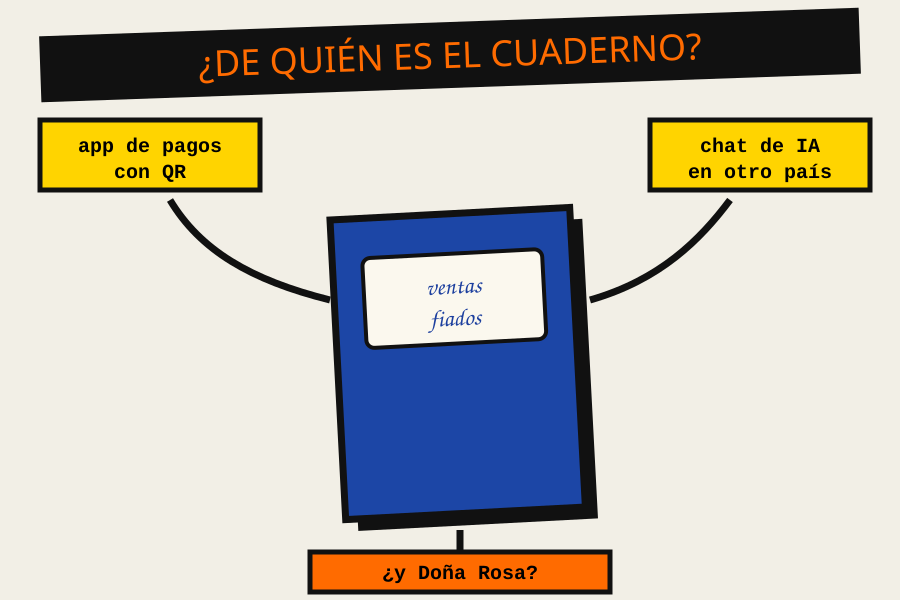
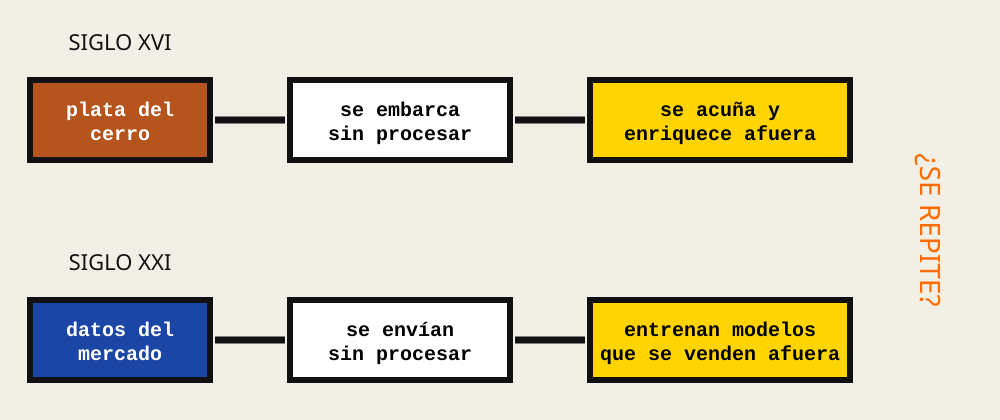
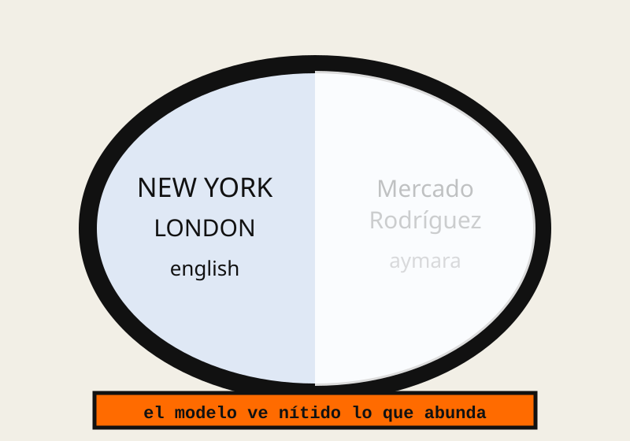

::: {.estilo-capitulo acento="naranja" motivo="rayas" imagen="../imagenes/cap11/apertura.svg"}
:::

::: {.callout-note collapse="true"}
## Ficha del capítulo
- **Objetivo de aprendizaje:** analizar con datos la situación digital de Bolivia, explicar qué es la soberanía de datos y por qué se compara con el extractivismo, y tomar decisiones de diseño que protejan los datos de las personas en un sistema real.
- **Prerrequisitos:** capítulo 7 (qué no delegar a una IA). No hace falta saber programar para leer la mayor parte del capítulo.
- **Proyecto guía:** Caserita hace su **mapa de datos**: qué sabe del puesto, dónde lo guarda, quién más lo ve y qué decide Doña Rosa sobre eso.
- **Temas que integra** (del plan original): el talento invisible de Latinoamérica; la brecha digital en Bolivia; el trabajo del futuro; soberanía de datos y extractivismo digital.
:::

::: {.grito}
¿Quién es dueño\
de lo que sabe\
el mercado?
:::

Hasta ahora el desorden fue técnico: instrucciones vagas, código enredado, máquinas que inventan. En la Parte IV el desorden es **social**. El mercado ya no es la metáfora de un programa: es el mercado de verdad, con sus caseras, sus deudas, sus precios y lo que todos saben de todos. Y la pregunta deja de ser "¿funciona?" para volverse "¿para quién funciona?".

| Si llegas hasta el final, podrás… | Lo practicas en… |
|---|---|
| Describir el orden de partida: conectividad y talento en Bolivia | @sec-c11-orden |
| Explicar tres fuerzas que desequilibran ese orden | @sec-c11-entropia |
| Comparar el extractivismo minero con la extracción de datos | @sec-c11-analisis |
| Diseñar un sistema que minimice y proteja los datos | @sec-c11-contencion |
| Reconocer qué ve y qué ignora un modelo sobre Bolivia | @sec-c11-ia |

: Ruta del capítulo {#tbl-c11-ruta}

## Orden {#sec-c11-orden}

### El mercado sabe

En un mercado nadie tiene una base de datos, y sin embargo el mercado **sabe**. Sabe qué casera tiene el mejor tomate los martes, quién paga sus fiados y quién no, cuándo sube el precio del pollo antes de que lo diga el noticiero. Ese conocimiento no está en un solo cuaderno: está repartido entre cientos de personas, y pertenece a quienes lo producen todos los días.

Doña Rosa lleva veintidós años alimentando ese saber. Su cuaderno de tapas azules es una pieza pequeña de algo mucho más grande: **la información de una comunidad sobre sí misma**. Ese es el orden de partida de este capítulo, y vale la pena mirarlo con números.

### El país conectado, en cifras

Bolivia es hoy un país mayoritariamente conectado. Según el informe *Digital 2026* de DataReportal, hacia octubre de 2025 había alrededor de **9 millones** de personas usuarias de internet, aproximadamente el **71 %** de la población [@datareportal2026]. A escala mundial, la Unión Internacional de Telecomunicaciones estimó para 2024 unos 5500 millones de personas conectadas, alrededor del **68 %** de la humanidad [@itu2024].

| Indicador | Valor | Fuente |
|---|---|---|
| Usuarios de internet en Bolivia (oct. 2025) | ≈ 9,0 millones | @datareportal2026 |
| Proporción de la población boliviana conectada | ≈ 71 % | @datareportal2026 |
| Personas conectadas en el mundo (2024) | ≈ 5500 millones | @itu2024 |
| Proporción mundial conectada (2024) | ≈ 68 % | @itu2024 |
| Personas en Bolivia **sin** conexión | ≈ 3,6 millones | Cálculo propio a partir de @datareportal2026 |

: Bolivia conectada: los números del punto de partida {#tbl-c11-cifras}

::: {.callout-note}
## Lee las cifras con ojo crítico
Las fuentes no siempre coinciden, y las de distintos años usan métodos distintos: DataReportal advierte que sus estimaciones se revisan cuando aparecen datos nuevos [@datareportal2026]. Compara siempre la misma fuente a lo largo del tiempo, y desconfía de cualquier cifra sin fecha ni origen. Esto, también, es reducir la entropía.
:::

### El talento que siempre estuvo

El otro pilar del orden es la gente. En las universidades bolivianas se forman cada año programadoras y programadores que, gracias al trabajo remoto, pueden trabajar para empresas de cualquier país sin moverse de El Alto, Cochabamba o Santa Cruz. Ese talento no es nuevo: lo nuevo es que ahora se ve desde afuera. [VERIFICAR: buscar una cifra de egresados de carreras de sistemas en Bolivia (por ejemplo, del CEUB o del Ministerio de Educación) antes de citar cualquier número.]

::: {.pizarra}
**Pizarra del Inge**

Cuando yo empecé, para programar en serio había que irse del país. Hoy basta con una conexión y un buen portafolio.

Pero fíjate en la trampa: que el talento **pueda** trabajar para afuera no significa que el país **construya** algo propio. Exportar horas de programación se parece mucho a exportar mineral.
:::

## Entropía {#sec-c11-entropia}

Tres fuerzas desordenan ese punto de partida. Ninguna es un error de programación; las tres son decisiones (o falta de decisiones) que se acumulan.

### Primera fuerza: la brecha

Que el 71 % esté conectado significa que alrededor de **uno de cada tres bolivianos no lo está**. Y la brecha no se reparte al azar: suele ser mayor en el área rural, entre las personas mayores y en los hogares con menos ingresos. Además, estar conectado no es lo mismo que **saber usar** la conexión para producir, aprender o defenderse. [VERIFICAR: cifra de conectividad urbana frente a rural en Bolivia, de la AGETIC, la ATT o el INE.]

Un sistema como Caserita, pensado para quien tiene un celular moderno y datos ilimitados, **deja afuera** justamente a quienes más lo necesitarían. La brecha digital no es solo un problema de antenas: es un problema de diseño.

### Segunda fuerza: el extractivismo de datos

::: {.figura-der ancho="44%"}
{#fig-c11-cuaderno}

Imagina que el mercado empieza a usar aplicaciones de pago con QR, de pedidos a domicilio y asistentes de IA. Cada venta, cada deuda y cada precio quedan registrados… en servidores de empresas que, en muchos casos, están en otros países.

Nick Couldry y Ulises Mejias llaman a esto **colonialismo de datos**: la apropiación de la vida cotidiana convertida en datos, de manera parecida a como el colonialismo histórico se apropió de tierras y recursos [@couldry2019]. Michael Kwet, desde Sudáfrica, describe un **colonialismo digital** en el que la infraestructura, el software y los datos del Sur Global quedan en manos de unas pocas corporaciones del Norte [@kwet2019].
:::

La palabra "colonialismo" es fuerte, y conviene usarla con cuidado: nadie obliga a Doña Rosa a usar una app a punta de fusil. Pero la estructura se parece. La **materia prima** (los datos del mercado) sale barata o gratis; el **procesamiento** (entrenar modelos, vender predicciones) ocurre lejos; y el **valor** se queda donde se procesa.

### Tercera fuerza: las reglas que faltan

Bolivia no tiene, a la fecha de escribir este capítulo, una ley integral de protección de datos personales. La Constitución reconoce el derecho a la privacidad y crea la **acción de protección de privacidad** (artículos 130 y 131), que permite a una persona pedir que se corrijan o eliminen datos suyos registrados de forma indebida [@cpe2009]. Hay proyectos de ley en discusión, pero no un marco completo con autoridad de control, obligaciones para las empresas y sanciones. [VERIFICAR: estado actualizado de los proyectos de ley de protección de datos personales en la Asamblea Legislativa Plurinacional antes de la entrega final.]

| Fuerza | Cómo se ve en el mercado | Qué la empeora con el tiempo |
|---|---|---|
| Brecha | Caseras sin datos móviles o sin saber usar la app | Cada servicio que **solo** existe en línea |
| Extracción | Ventas y deudas guardadas en servidores ajenos | Cada nueva app que nadie lee antes de aceptar |
| Reglas que faltan | Nadie sabe a quién reclamar si se filtra la lista de deudores | Cada año sin una ley ni una autoridad |

: Las tres fuerzas que desordenan el punto de partida {#tbl-c11-fuerzas}

::: {.recorte}
"Es América Latina, la región de las venas abiertas." — Eduardo Galeano, 1971 [@galeano1971].
:::

## Análisis {#sec-c11-analisis}

### De las minas a los datos

La comparación entre minería y datos no es un adorno retórico; se puede poner en una tabla y discutir fila por fila.

::: {.figura-pie lado="izq" ancho="78%"}
{#fig-c11-cadena}
:::

| Eslabón | Minería (Potosí, siglos XVI–XVIII) | Datos (siglo XXI) |
|---|---|---|
| Materia prima | Plata del Cerro Rico | Lo que hacemos, compramos, decimos y buscamos |
| Quién la produce | El trabajo de mitayos y mineros | El trabajo cotidiano de millones de personas |
| Dónde se transforma | Casas de moneda y bancos de Europa | Centros de datos y laboratorios de IA, sobre todo fuera de la región |
| Qué vuelve | Mercancías manufacturadas | Servicios digitales, muchas veces "gratis" a cambio de más datos |
| Dónde se queda el valor | Fuera del territorio | Fuera del territorio |
| Qué queda en el lugar | Socavones y deuda | Dependencia tecnológica y poca capacidad propia |

: De las minas a los datos: la cadena comparada {#tbl-c11-minas}

La comparación tiene límites honestos. Los datos no se agotan como la plata; una misma información se puede usar muchas veces. Y los servicios digitales sí traen beneficios reales: Doña Rosa cobra más rápido con QR. **El problema no es la tecnología, sino quién decide y quién se queda con el valor.**

### Qué es la soberanía de datos

::: {.pizarra}
**Pizarra del Inge**

**Soberanía de datos** es la capacidad de una persona, una comunidad o un país de **decidir** sobre los datos que produce: dónde se guardan, quién los usa, para qué y con qué beneficio.

No significa encerrar los datos. Significa que la llave la tenga quien los produce.
:::

Para que la definición no quede en el aire, mírala en tres escalas:

| Escala | Pregunta de soberanía | Ejemplo en el mercado |
|---|---|---|
| Persona | ¿Puedo ver, corregir y borrar lo que se sabe de mí? | Un casero pide que su deuda pagada desaparezca del registro |
| Comunidad | ¿El saber colectivo beneficia a quienes lo producen? | Los precios del mercado sirven a las caseras, no solo a un intermediario |
| País | ¿Hay capacidad propia para guardar, procesar y regular? | Infraestructura, leyes y profesionales bolivianos |

: Soberanía de datos en tres escalas {#tbl-c11-escalas}

### El ciclo de vida de un dato del puesto

Para decidir sobre un dato, primero hay que seguirlo. Este es el recorrido de una sola deuda de fiado:

```{mermaid}
%%| label: fig-c11-ciclo
%%| fig-cap: "El recorrido de una deuda de fiado: en cada paso hay una decisión de soberanía."
flowchart TD
  A["Paso 1: Se genera: Don Lucho se lleva arroz fiado"] --> B["Paso 2: Se registra: cuaderno o Caserita"]
  B --> C{"Paso 3: ¿Dónde se guarda?"}
  C -->|"en el puesto"| D[Control de Doña Rosa]
  C -->|"en un servidor externo"| E[Control compartido con una empresa]
  E --> F{"Paso 4: ¿Se usa para otra cosa?"}
  F -->|"entrenar modelos, vender perfiles"| G[El valor sale del mercado]
  F -->|"no, por contrato y por diseño"| H[El valor se queda]
  D --> I["Paso 5: Se borra cuando la deuda se paga"]
  H --> I
```

### El trabajo del futuro, visto desde aquí

La IA cambia también el trabajo de quien programa. Si el código se escribe más rápido (capítulo 7), el valor se mueve hacia lo que la máquina hace mal: **entender el problema local, decidir, verificar y responder**. Paradójicamente, eso favorece a quien conoce de cerca un contexto que los modelos ven mal (@sec-c11-ia). Una programadora de Sucre que entiende cómo funciona un mercado, una cooperativa minera o un centro de salud rural tiene algo que ningún modelo entrenado en Silicon Valley trae de fábrica.

| Si el talento local solo… | Si el talento local también… |
|---|---|
| Vende horas de código a empresas de afuera | Construye productos para problemas de aquí |
| Usa modelos ajenos tal como vienen | Adapta, evalúa y controla los modelos que usa |
| Entrega los datos de sus usuarios a terceros | Diseña sistemas que guardan los datos bajo control local |
| Repite el patrón de exportar materia prima | Rompe el patrón con valor agregado |

: Dos caminos para el talento local {#tbl-c11-caminos}

## Contención {#sec-c11-contencion}

Las fuerzas sociales no se arreglan con una función de Python. Pero quien diseña sistemas **sí** puede elegir, en cada sistema, si empuja hacia la extracción o hacia la soberanía.

::: {.manifiesto}
1. Ningún dato que no sea necesario: lo que no se guarda no se filtra.
2. Ningún dato de personas en un servicio externo sin decirlo y sin permiso.
3. Ningún sistema sin una salida: la persona puede llevarse sus datos.
4. Ninguna deuda pagada que siga en el registro.
5. Ningún sistema que solo funcione con internet perfecto.
:::

### Minimizar antes de enviar

Vuelve a la Custodia del capítulo 7: la lista de deudores no se pega en un chat externo. Pero ¿y si necesitas que una IA te ayude a analizarla? Se **minimiza** y se **seudonimiza** primero: cada nombre se reemplaza por un código, y la tabla que relaciona códigos con nombres se queda en el puesto.

```python
import hashlib

SAL = "cambia-esto-y-no-lo-compartas"                       # <1>

def seudonimo(nombre):
    huella = hashlib.sha256((SAL + nombre).encode()).hexdigest()
    return "casero-" + huella[:6]                            # <2>

caseros = {"Don Lucho": 12050, "Doña Eva": 2000}

tabla_local = {seudonimo(n): n for n in caseros}             # <3>
para_enviar = {seudonimo(n): d for n, d in caseros.items()}  # <4>

print(para_enviar)
# {'casero-…': 12050, 'casero-…': 2000}
```
1. Un texto secreto que solo conoce el puesto. Sin él, nadie puede recalcular los seudónimos a partir de los nombres.
2. El nombre se convierte en un código corto y estable: el mismo casero recibe siempre el mismo código.
3. La tabla que permite volver de código a nombre **nunca sale del puesto**.
4. Esto es lo único que se comparte: montos sin nombres.

No es una protección perfecta (con pocos caseros y otros datos, alguien podría adivinar quién es quién), pero es mucho mejor que pegar nombres y deudas tal cual.

::: {.callout-important}
## Reto: el mapa de datos de Caserita

Haz el inventario de datos del puesto de Doña Rosa (o de un negocio real que conozcas, con permiso).

1. Lista **todos** los datos que Caserita guarda o podría guardar (productos, ventas, fiados, teléfonos de caseros…).
2. Para cada dato, completa una tabla con estas columnas: *¿es dato personal?*, *¿para qué se necesita?*, *¿dónde se guarda?*, *¿quién más lo ve?*, *¿cuándo se borra?*
3. Marca en rojo los datos que **no** son necesarios y propón eliminarlos.
4. Escribe una política de una página, en lenguaje que Doña Rosa entienda, que explique a sus caseros qué se guarda de ellos y cómo pueden pedir que se borre.

**Criterio de logro:** la tabla no tiene ninguna celda vacía, al menos un dato quedó eliminado por innecesario y la política se entiende sin palabras técnicas.
:::

## Ojo de la IA {#sec-c11-ia}

::: {.callout-tip icon="false"}
## Ojo de la IA
En la Parte IV, el ojo de la IA pregunta **qué ve el modelo y qué ignora**.

::: {.figura-izq ancho="40%"}
{#fig-c11-espejo}

Un modelo de lenguaje aprende de los textos con los que se entrenó (capítulo 6). Si en esos textos hay millones de páginas sobre los mercados de Nueva York y casi nada sobre el Mercado Rodríguez de La Paz, el modelo **verá nítido lo primero y adivinará lo segundo**, con la misma seguridad en ambos casos.

Haz la prueba: pregúntale a un asistente de IA por el precio del quintal de arroz en un mercado de tu ciudad, o por una norma boliviana específica. Compara su respuesta con una fuente local. Lo que encuentres es un dato sobre el modelo, no sobre Bolivia.
:::

| Sobre Bolivia, un modelo general… | Suele ver | Suele ignorar o inventar |
|---|---|---|
| Geografía e historia general | Lo que aparece en enciclopedias internacionales | Lo local, lo reciente, lo que solo existe en medios bolivianos |
| Leyes y trámites | Que existe una Constitución | Detalles de normas, decretos y su estado actual |
| Economía cotidiana | Promedios regionales | Precios del mercado, el fiado, el trueque, la economía informal |
| Lenguas | Español estándar | Aymara, quechua, guaraní y el castellano boliviano (capítulo 12) |

**Lo que debe revisar una persona:** toda afirmación del modelo sobre el contexto boliviano se contrasta con una fuente local con fecha. Y, como diseñadora o diseñador de sistemas, pregúntate: si los modelos ven mal a Bolivia, ¿quién va a producir los datos y los modelos que sí la vean bien, y bajo qué reglas?
:::

## Custodia {#sec-c11-custodia}

::: {.callout-warning icon="false"}
## Custodia
La recomendación de la UNESCO sobre la ética de la IA, adoptada por sus Estados miembros en 2021, pide proteger la privacidad y los datos personales durante todo el ciclo de vida de los sistemas de IA y fortalecer las capacidades de los países para gobernarlos [@unesco2021]. Es un buen marco, pero ningún marco reemplaza las decisiones de quien construye el sistema.

Lo que te toca proteger, como desarrolladora o desarrollador boliviano:

- **Los datos de las personas** que usan lo que construyes, empezando por no recolectar de más.
- **La capacidad de decidir** de tus usuarios: que sepan qué se guarda y puedan llevárselo o borrarlo.
- **El valor que produce tu comunidad**, para que no salga siempre en bruto.
- **A quienes están del otro lado de la brecha**, para que tu sistema no los deje afuera.

La pregunta del prefacio sigue en pie: con los datos y la IA, ¿vamos a repetir el patrón de extraer materia prima para que otros la transformen, o vamos a construir tecnología propia? No la responde una ley ni un modelo. La responde cada sistema que se diseña.
:::

## Para cerrar

::: {.pizarra}
**Pizarra del Inge: lo que te llevas**

- El mercado **sabe**: el conocimiento de una comunidad es un bien que pertenece a quien lo produce.
- Bolivia está conectada en un 71 %; el otro tercio también cuenta.
- Tres fuerzas de desorden social: **la brecha, la extracción de datos y las reglas que faltan**.
- Soberanía de datos = **la llave la tiene quien produce el dato**, en tres escalas: persona, comunidad y país.
- Contención de diseño: minimizar, seudonimizar, dar salida, borrar a tiempo y funcionar sin internet perfecto.
:::

**Preguntas de repaso**

1. ¿En qué se parece y en qué se diferencia la extracción de datos de la extracción de plata en Potosí? Usa al menos dos filas de la @tbl-c11-minas y un límite de la comparación.
2. ¿Qué protege la acción de protección de privacidad de la Constitución boliviana y qué le falta a Bolivia frente a un marco integral de protección de datos?
3. En el código de seudonimización, ¿por qué la `tabla_local` nunca debe salir del puesto?

**Para profundizar**

- Couldry y Mejias, *The Costs of Connection* [@couldry2019]: el concepto de colonialismo de datos.
- Kwet, *Digital Colonialism* [@kwet2019]: infraestructura y poder digital en el Sur Global.
- Galeano, *Las venas abiertas de América Latina* [@galeano1971]: la historia larga de la extracción en la región.
- DataReportal, *Digital 2026: Bolivia* [@datareportal2026] y UIT, *Facts and Figures 2024* [@itu2024]: los números del punto de partida.
- UNESCO, *Recomendación sobre la ética de la IA* [@unesco2021]: el marco internacional.

| Palabra | En una línea |
|---|---|
| Brecha digital | Diferencia entre quienes pueden usar las tecnologías digitales y quienes no |
| Dato personal | Información que identifica o permite identificar a una persona |
| Soberanía de datos | Capacidad de decidir sobre los datos que uno produce |
| Colonialismo de datos | Apropiación de la vida cotidiana convertida en datos para el beneficio de otros |
| Minimización | Guardar solo los datos estrictamente necesarios |
| Seudonimización | Reemplazar los identificadores por códigos, guardando la clave por separado |

: Glosario del capítulo {#tbl-c11-glosario}

::: {.callout-note appearance="minimal"}
**Caserita, mapa de datos:** el sistema ya sabe qué guarda, dónde y para qué. En el capítulo 12 miraremos lo que ningún mapa de datos alcanza a ver: nuestras lenguas, el costo ambiental de la IA y las reglas que el país todavía tiene que escribir.
:::
